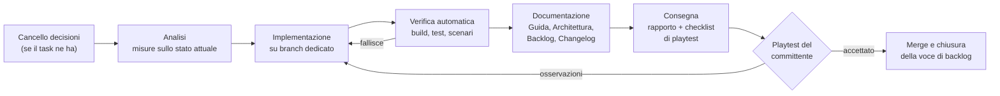
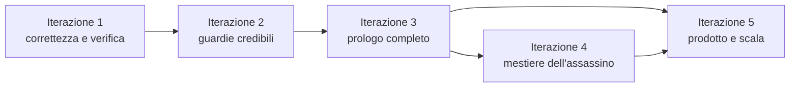

# The Pale Stitch — Piano dei task agentici

| | |
|---|---|
| Versione del documento | 1.0 |
| Data | 21 novembre 2026 |
| Stato del software | 0.0.1 + CR-021 (perimetro del prologo) |
| Documenti collegati | [Backlog](BACKLOG.md) · [Architettura](tech/ARCHITECTURE.md) · [Technical Guide](tech/TECHNICAL_GUIDE.md) · [Design](design/01-prologo-video-schermate.md) · [Changelog](../CHANGELOG.md) |

Il [Backlog](BACKLOG.md) dice **che cosa** c'è da fare. Questo piano dice **in che ordine**, **come** viene eseguito ogni task da Claude in modo agentico, e **quali decisioni** servono dal committente prima di ciascun blocco di lavoro.

---

## 1. Modello operativo

### 1.1 Ruoli

| Ruolo | Chi | Responsabilità |
|---|---|---|
| Committente | Valerio | Decisioni di design e di prodotto, playtest, accettazione, merge su `develop` e `main` |
| Esecutore | Claude | Analisi, implementazione, test automatici, documentazione, rapporto di consegna |

### 1.2 Ciclo di un task

Ogni task del piano segue lo stesso ciclo:

1. **Cancello decisioni.** Se il task dipende da una decisione aperta (§4), Claude non parte finché non c'è la risposta. Le decisioni di un'iterazione vengono chieste tutte insieme, all'inizio dell'iterazione.
2. **Analisi.** Prima di cambiare il comportamento, Claude lo misura (scenari automatici, mappe di raggiungibilità, valori dal vivo). Il rapporto di consegna riporta il prima e il dopo.
3. **Implementazione** su un branch `feature/<id>` o `fix/<id>`, toccando solo ciò che il task richiede.
4. **Verifica automatica.** Compilazione senza errori né avvisi, test unitari, scenari di gioco senza finestra, test di giocabilità (dall'iterazione 2). Un task non si consegna con una verifica rossa.
5. **Documentazione nello stesso task:** Technical Guide e Architettura se cambia un algoritmo o la struttura, stato della voce nel Backlog, riga nel Changelog. La documentazione non resta indietro rispetto al codice.
6. **Consegna:** riepilogo breve, numeri misurati, istruzioni di playtest (che cosa provare, che cosa aspettarsi).
7. **Playtest e accettazione** del committente. Le osservazioni diventano correzioni nello stesso task o nuove voci di backlog.

### 1.3 Definizione di "fatto"

Un task è chiuso quando:

- [ ] i criteri di accettazione della voce di backlog sono verificati;
- [ ] la compilazione dà 0 errori e 0 avvisi;
- [ ] i test automatici esistenti passano e quelli nuovi coprono la modifica (dall'iterazione 1);
- [ ] i test di giocabilità rispettano le soglie (dall'iterazione 2);
- [ ] documentazione, Backlog e Changelog sono aggiornati;
- [ ] il committente ha accettato il playtest.

### 1.4 Regole

- **Una voce di backlog, un commit** (o una piccola serie), con messaggio `tipo(ID): descrizione`.
- **Le scene si modificano in modo mirato.** Da ora in poi le scene `.tscn` sono la fonte di verità: Claude applica modifiche puntuali e non rigenera interi file. Così le modifiche fatte dal committente nell'editor non vanno perse.
- **Nessuna modifica nascosta.** Ogni cambiamento di comportamento percepibile in gioco compare nel rapporto di consegna e nel Changelog.
- **Numeri misurati, non stimati.** Bilanciamento e difficoltà si giudicano con i test di giocabilità (CR-027), poi con il playtest.

---

## 2. Iterazioni

| Iterazione | Obiettivo | Voci | Stima | Decisioni ancora aperte |
|---|---|---|---|---|
| **0** | Documentazione e perimetro del prologo | CR-021 | — | — (completata) |
| **1** | Correttezza, comandi e strumenti di verifica | FIX-001, 003, 004, 006, 008, 009, 010, 011, 012 · CR-022 · CR-012, CR-008, CR-011, CR-020 · FIX-002 | 5–6 giornate | nessuna |
| **2** | "Nessuna stupidità": guardie credibili | CR-023, 024, 025, 026, 027 · FIX-005, 007, 013 | 8–10 giornate | D-06, D-07, D-07b, D-08, D-09, D-10 |
| **3** | Prologo completo | CR-001, CR-014, CR-003, CR-004, CR-007 (prima parte) | 3–4 settimane | D-01, D-11 |
| **4** | Il mestiere dell'assassino | CR-005, CR-018, CR-015 (resto), CR-002 | 3–4 settimane | da definire alla fine dell'iterazione 3 |
| **5** | Prodotto e scala | CR-006, CR-009, CR-010, CR-013, CR-016, CR-017, CR-019, NTH-001, NTH-002, NTH-010 | da stimare | D-12, D-13, D-14 |

Le stime sono giornate di lavoro di sviluppo, esclusi asset artistici e audio. Le iterazioni 3–5 verranno dettagliate in schede di task alla fine dell'iterazione precedente: dettagliarle ora vorrebbe dire pianificare su un'IA e un prologo che stanno per cambiare.

---

## 3. Schede dei task

### Iterazione 1 — Correttezza, comandi e strumenti di verifica

**Perché per prima.** L'iterazione 2 riscrive la percezione delle guardie e va tarata con precisione. Per farlo servono un'IA senza difetti noti, un pannello che mostri coni, raggi e valori, e test automatici che dicano se una modifica ha peggiorato qualcosa.

#### T-1.1 · Correzioni rapide

| | |
|---|---|
| Voci | FIX-001, FIX-003, FIX-004, FIX-006, FIX-010, FIX-011, FIX-012 |
| Dipende da | — |
| Stima | 1 giornata |

**Passi.** Maschere di collisione giocatore/guardia; calcolo del sospetto all'udito; due canali nell'HUD (istruzioni di contesto e notifiche); un solo punto per la formula del mascheramento; tween dei suggerimenti con `Kill()`; rimozione del codice inutilizzato; rinomina `Variant` → `Dye`.

**Verifica automatica.** Scenario: il giocatore cammina contro la guardia ferma e non la attraversa. Scenario: campana durante la serratura, al termine le istruzioni sono di nuovo visibili. Test unitario del sospetto (FIX-003).

**Playtest.** Prova a passare attraverso la guardia; scassina mentre suona la campana.

#### T-1.2 · Furtivo a interruttore

| | |
|---|---|
| Voci | CR-022 (chiude anche FIX-005), FIX-009 |
| Dipende da | D-03, D-04 |
| Stima | ½ giornata |

**Passi.** Andatura scelta dal giocatore come stato persistente; C e Ctrl alternano il furtivo; Shift secondo D-04; stato "in azione" separato dall'andatura con il fattore di visibilità deciso in D-03. Nei testi del tutorial i nomi dei tasti diventano segnaposto riempiti con i tasti reali (FIX-009), così il cambio dei comandi non li rende falsi. Aggiornamento della tabella comandi in README, Design e Guida §8.5 e §18.

**Verifica automatica.** Test di input simulato: pressione e rilascio di C → furtivo attivo; seconda pressione → disattivo; serratura iniziata e annullata → andatura ripristinata.

**Playtest.** Attraversa la strada in furtivo senza tenere premuto nulla; prova la corsa partendo dal furtivo.

#### T-1.3 · Fondamenta di verifica

| | |
|---|---|
| Voci | CR-012, CR-011 (prima parte) |
| Dipende da | D-02 |
| Stima | 2 giornate |

**Passi.**
1. `global.json` per l'SDK 10.
2. Progetto di test xUnit per la logica pura: formule del personaggio, mascheramento, sospetto (estratto in funzioni pure dove serve).
3. **Banco di scenari**: un runner che avvia il gioco senza finestra, esegue uno script di input e controlla dei risultati. È la formalizzazione degli scenari già usati nelle analisi del 21 novembre 2026 (inseguimento della guardia, mappa di raggiungibilità).
4. La **mappa di raggiungibilità** diventa uno strumento del repository: si lancia su un livello e produce l'immagine dell'area calpestabile e un numero di m² da confrontare con quello atteso.
5. Uno script unico `verify` che esegue compilazione, test e scenari e produce un rapporto.

**Fuori da questo task:** la CI su GitHub Actions (seconda parte di CR-011), rimandata all'iterazione 5 a meno che D-02 non la anticipi.

#### T-1.4 · Pannello di debug e costanti dei layer

| | |
|---|---|
| Voci | CR-020, CR-008 |
| Dipende da | — |
| Stima | 1½ giornate |

**Passi.** Tasto F3 nelle build di debug: coni visivi e sospetto delle guardie, raggi di rumore, raycast di luce e vista disegnati nel mondo, valori numerici dell'esposizione. Classe `PhysicsLayers` con test che la confronta con `project.godot`.

**Playtest.** Gioca il prologo con F3 attivo e verifica che ciò che vedi coincida con ciò che succede.

#### T-1.5 · Fluidità visiva

| | |
|---|---|
| Voci | FIX-002, FIX-008 |
| Dipende da | — |
| Stima | ½ giornata |

**Passi.** Interpolazione fisica attivata; reset dell'interpolazione al ricomincio del livello; `SceneRouter` con coda dell'ultima richiesta e `try/finally`.

**Playtest.** Su un monitor oltre i 60 Hz, cammina in linea retta osservando lo sfondo.

**Fine iterazione 1:** rilascio `0.1.0`.

### Iterazione 2 — "Nessuna stupidità": guardie credibili

**Obiettivo misurabile.** Il percorso di riferimento del prologo riesce nella percentuale fissata da D-09; i percorsi negligenti, compreso "fermo in piedi dietro la guardia", falliscono.

#### T-2.1 · Banco di giocabilità

| | |
|---|---|
| Voci | CR-027 |
| Dipende da | T-1.3, D-09, D-10 |
| Stima | 1½ giornate |

**Passi.** Percorsi scritti come sequenze di marcatori e comandi nel livello (un percorso di riferimento, almeno tre negligenti); esecuzione ripetuta con semi casuali diversi; rapporto con percentuale di successo, tempo medio, punto in cui si viene scoperti. **Viene fatto per primo** e lanciato anche sull'IA attuale, così ogni task successivo mostra di quanto ha spostato i numeri.

#### T-2.2 · Percezione per parti del corpo

| | |
|---|---|
| Voci | CR-023 |
| Dipende da | T-2.1 |
| Stima | 2 giornate |

**Passi.** Sette punti del corpo che seguono la postura; esposizione alla luce per punto; raycast di vista per punto; regola di D-05: busto in luce nel cono → allarme istantaneo; arti in luce → forte sospetto, con tempo di reazione e brusche girate di testa verso vicoli e nascondigli. Aggiornamento della Guida §20 e §22 con algoritmo ed esempi numerici nuovi.

#### T-2.3 · Visione periferica, sguardi e allerta

| | |
|---|---|
| Voci | CR-024, CR-025 |
| Dipende da | T-2.2, D-06, D-07 |
| Stima | 2½ giornate |

**Passi.** Cono periferico; sguardi spontanei con frequenza governata dall'allerta e dal tempo; preavviso visibile prima di ogni rotazione; livello di allerta per guardia secondo D-07. Il generatore casuale è unico per livello e il suo seme viene registrato (D-10).

#### T-2.4 · Ronda adattiva

| | |
|---|---|
| Voci | CR-026, FIX-013 |
| Dipende da | T-2.3, D-08 |
| Stima | 1½ giornate |

**Passi.** Comportamenti per livello di allerta; ronda estesa e punti di perlustrazione (marcatori nel livello o calcolati, secondo D-08); ingresso nei vicoli con la lanterna; meta di navigazione aggiornata solo quando cambia.

#### T-2.5 · Correttezza del tempo fisico e taratura finale

| | |
|---|---|
| Voci | FIX-007 |
| Dipende da | T-2.4 |
| Stima | 1 giornata |

**Passi.** Logica della serratura nel passo fisico; rumori consegnati all'inizio del passo fisico. Poi taratura dei parametri finché il banco di giocabilità rispetta le soglie; rapporto finale con i numeri prima e dopo l'iterazione.

**Playtest dell'iterazione.** Due sessioni: una "da principiante" (il prologo è il tutorial) e una "provocatoria", in cui cerchi di stare fermo vicino alla guardia, di indugiare, di nasconderti sempre nello stesso vicolo.

**Fine iterazione 2:** rilascio `0.2.0`.

---

## 4. Registro delle decisioni

Ogni decisione ha una raccomandazione motivata. Le decisioni dell'iterazione imminente vengono chieste in chat; le risposte vengono registrate qui con data.

### Decisioni per l'iterazione 1

Le decisioni D-02, D-03 e D-04 sono state prese il 21 novembre 2026 (vedi "Decisioni prese").

| Id | Decisione | Opzioni | Raccomandazione | Voci |
|---|---|---|---|---|
| **D-02** | Chi esegue i commit git | (a) Claude prepara le modifiche, il committente committa (come ora); (b) Claude committa su branch `feature/<id>`, il committente fa il merge dopo il playtest | **(b)**: storia pulita, una voce per commit, nessun lavoro perso tra un task e l'altro. Richiede di concedere a Claude il permesso di cancellare file nella cartella del progetto, perché git crea e rimuove file di blocco | tutte |
| **D-03** | Visibilità durante un'azione in prima persona (serratura) | (a) neutra, ×1,0; (b) più visibile, ×1,15; (c) meno visibile, ×0,75 (comportamento attuale, involontario) | **(a) neutra**: il rischio dell'azione viene già dal rumore degli attrezzi e dal tempo che passa | CR-022, FIX-005 |
| **D-04** | Furtivo e corsa | (a) tenendo Shift si corre, al rilascio si torna furtivi; (b) Shift annulla il furtivo, al rilascio si cammina | **(a)**: la corsa è un'eccezione consapevole, il furtivo è lo stato scelto | CR-022 |

### Decisioni per l'iterazione 2

| Id | Decisione | Opzioni | Raccomandazione | Voci |
|---|---|---|---|---|
| **D-06** | Sguardi spontanei | Preavviso: 0,4 / 0,6 / 0,8 s. Frequenza media da calma: uno ogni 15 / 10 / 6 s, che si dimezza a ogni livello di allerta | **Preavviso 0,6 s, uno ogni 10 s da calma** come punto di partenza, poi taratura con il banco di giocabilità | CR-024 |
| **D-07** | Modello dell'allerta | (a) continuo, da 0 a 1; (b) quattro livelli: *calmo*, *inquieto*, *sospettoso*, *in caccia* | **(b)**: ogni livello ha un comportamento riconoscibile dal giocatore ed è facile da testare | CR-025, CR-026 |
| **D-07b** | L'allerta si vede nell'HUD? | (a) solo dal comportamento della guardia e dal segno sopra la testa; (b) anche un indicatore nell'HUD | **(a)**: coerente con l'HUD minimale e più inquietante | CR-025 |
| **D-08** | Ronda estesa e punti di perlustrazione | (a) marcatori disposti a mano nel livello; (b) calcolati dalla mappa della luce (le zone più buie vicino al percorso) | **(a) per il prologo**: controllo totale del level design; (b) valutabile in seguito per livelli grandi | CR-026 |
| **D-09** | Soglie di "difficile, non impossibile" | Percorso di riferimento riuscito in almeno: 70 / 80 / 90 % dei tentativi; percorsi negligenti riusciti al massimo nel 10 % | **80 % e 10 %**, su 50 tentativi con semi diversi | CR-027 |
| **D-10** | Casualità delle guardie | (a) seme nuovo a ogni tentativo; (b) seme fisso per livello: ogni tentativo identico | **(a)**, con il seme registrato in modo che ogni partita sia riproducibile nei test | CR-024, CR-027 |

### Decisioni per le iterazioni successive

| Id | Decisione | Opzioni | Raccomandazione | Quando |
|---|---|---|---|---|
| **D-01** | Edifici che coprono il personaggio | Sagoma attraverso i muri; muri trasparenti attorno al giocatore; tetti e facciate che si scoperchiano negli interni; combinazione | **Sagoma + tetti che si scoperchiano negli interni** | Inizio iterazione 3 |
| **D-11** | Sceneggiatura degli interni del mercante (momenti D–G) | Approvazione di uno storyboard che Claude prepara all'inizio dell'iterazione 3 | — | Inizio iterazione 3 |
| **D-12** | Salvataggio | Libero; solo a punti di controllo | **Punti di controllo**: in un gioco di furtività il salvataggio libero annulla il rischio | Iterazione 5 |
| **D-13** | Il volto cambia le reazioni dei personaggi? | Solo estetico; reazioni diverse | Da discutere quando esisteranno personaggi non ostili | Iterazione 5 |
| **D-14** | Il giocatore esperto può saltare il prologo? | Sì, dal menu; sì, dopo averlo completato una volta; no | **Sì, dopo averlo completato una volta** | A prologo completo |

### Decisioni prese

| Id | Decisione | Esito | Data |
|---|---|---|---|
| — | Premessa narrativa | Confermata | 21 novembre 2026 |
| — | Nessuna scorciatoia che aggiri la sfida; perimetro chiuso con muri | Adottato come principio di level design (CR-021) | 21 novembre 2026 |
| — | Furtivo a interruttore, corsa tenuta premuta | Requisito (CR-022) | 21 novembre 2026 |
| — | "Difficile, non impossibile, nessuna stupidità degli avversari" | Principio della furtività (Design §6) | 21 novembre 2026 |
| D-02 | Commit git | Claude committa su branch dedicati, uno per voce di backlog; il committente fa il merge dopo il playtest. Serve il permesso di cancellazione nella cartella del progetto, da chiedere all'avvio dell'iterazione 1 | 21 novembre 2026 |
| D-03 | Visibilità durante un'azione in prima persona | Neutra (×1,0): il rischio viene dal rumore degli attrezzi e dal tempo | 21 novembre 2026 |
| D-04 | Furtivo e corsa | Tenendo Shift si corre; al rilascio si torna nel furtivo scelto | 21 novembre 2026 |
| D-05 | Che cosa succede quando la guardia coglie il personaggio in luce | **Busto in luce nel cono: allarme istantaneo** (con il volto riconosciuto, è game over). **Spalla, braccio o gamba in luce: forte sospetto, non certezza.** La guardia ha un tempo di reazione reale, perché non sa se ha visto un ladro o un bagliore; ma è in tensione, perché deve sorvegliare e non c'è nulla che la distragga. Il sospetto cambia i suoi schemi di ronda, con brusche girate di testa verso vicoli e nascondigli | 21 novembre 2026 |

---

## 5. Rischi

| Rischio | Effetto | Mitigazione |
|---|---|---|
| L'IA più severa rende il prologo frustrante per un principiante | Abbandono al tutorial | Soglie di D-09 misurate a ogni modifica; preavvisi leggibili; playtest "da principiante" |
| La casualità rende i fallimenti percepiti come ingiusti | Il giocatore incolpa il gioco | Preavviso prima di ogni sguardo; seme registrato per riprodurre ogni caso segnalato |
| Più raycast per guardia (sette punti, due coni) | Costo che cresce con il numero di guardie | Calcolo dei punti a frequenza ridotta e solo entro il cono periferico; misura nel profiler a fine iterazione 2 |
| Modifiche alle scene sia nell'editor sia da Claude | Lavoro perso | Modifiche puntuali alle scene (§1.4); commit per task (D-02) |
| Documentazione che resta indietro | La guida smette di essere affidabile | Aggiornamento obbligatorio nella definizione di "fatto" |
