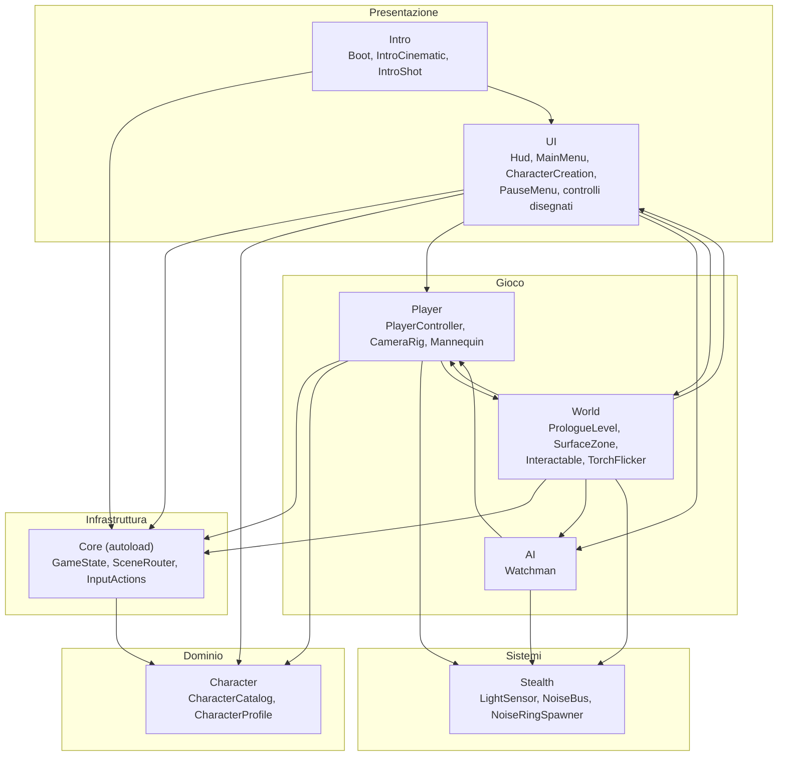
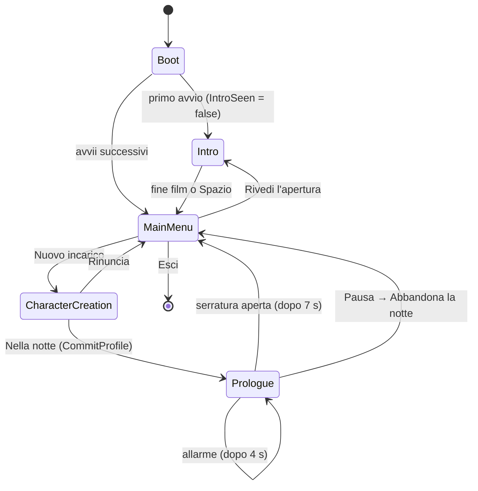
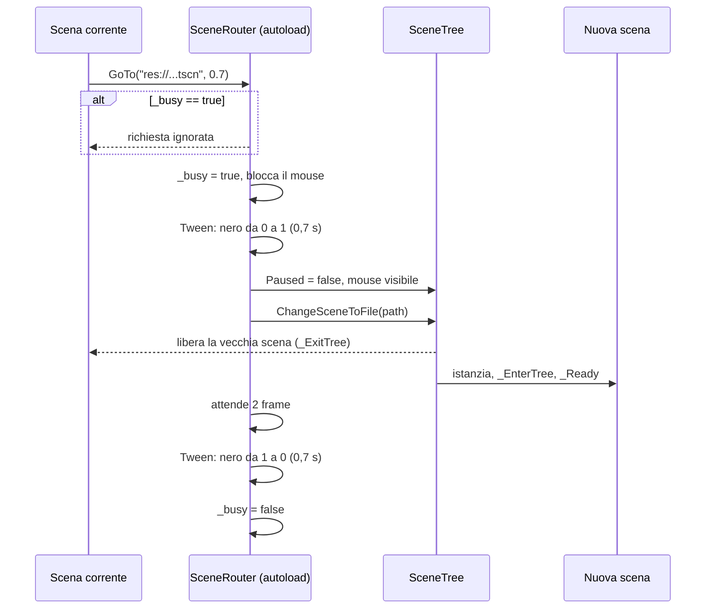
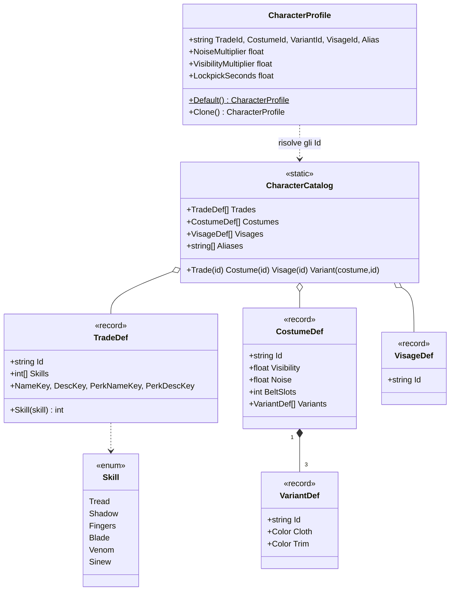
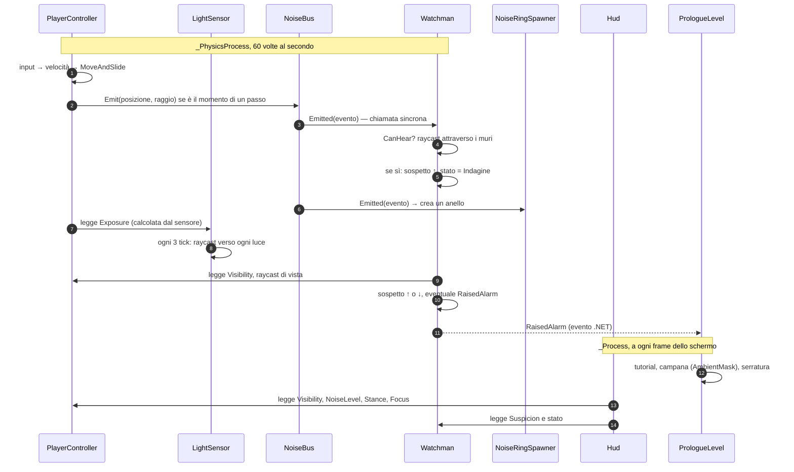
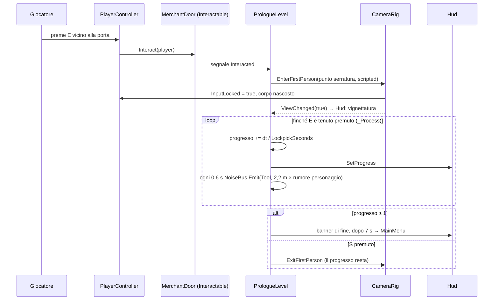
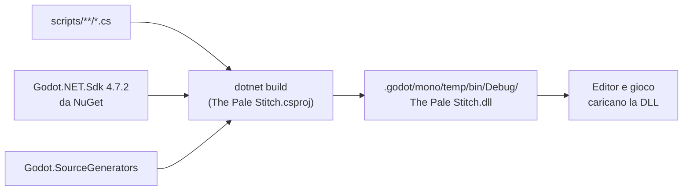
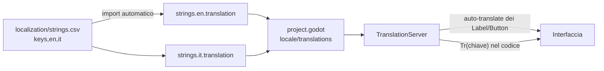

# The Pale Stitch — Architettura del software

| | |
|---|---|
| Versione del documento | 1.0 |
| Versione del software descritta | 0.0.1 (graybox del prologo), commit `b5b2eec` sul branch `develop` |
| Data | 21 novembre 2026 |
| Documenti collegati | [Technical Guide](TECHNICAL_GUIDE.md) · [Backlog](../BACKLOG.md) · [Changelog](../../CHANGELOG.md) · [Design: prologo, video, schermate](../design/01-prologo-video-schermate.md) |

Questo documento descrive **com'è fatto** il software oggi: moduli, dipendenze, flussi a runtime, dati e decisioni. Il **perché funziona così**, cioè i concetti di Godot e gli algoritmi spiegati passo passo, è nella Technical Guide. Se non hai mai lavorato con un motore di gioco, leggi prima la Parte I della guida (capitoli 1–12): qui i termini *nodo*, *scena*, *segnale*, *autoload* e *layer di collisione* sono dati per noti.

---

## 1. Ambito e stato

The Pale Stitch è un gioco stealth in 3D con camera isometrica e passaggi in prima persona. La versione 0.0.1 è una **graybox**: geometria a blocchi, nessun audio, ritratti disegnati dal codice. Contiene però già tutte le schermate e i tre sistemi centrali del gameplay:

| Area | Stato |
|---|---|
| Flusso schermate (avvio, video, menu, creazione personaggio, livello, pausa) | Completo |
| Sistema luce/ombra (esposizione del personaggio) | Prima versione funzionante |
| Sistema suono (propagazione del rumore) | Prima versione funzionante, solo in linea retta |
| IA della guardia (ronda, indagine, allarme) | Prima versione funzionante |
| Prologo | Giocabile fino alla serratura del mercante |
| Salvataggio, audio, modelli definitivi, abilità Lama/Veleno/Nerbo | Assenti |

---

## 2. Stack tecnologico

| Elemento | Scelta | Note |
|---|---|---|
| Motore | Godot 4.7.2, edizione .NET | `X:/Installations/Godot_v4.7.2-stable_mono_win64` |
| Linguaggio | C# 12 | Nessuno script GDScript nel gioco |
| Framework .NET compilato | `net8.0` | Godot avvia il runtime .NET con la propria configurazione (`GodotPlugins.runtimeconfig.json`, `rollForward: LatestMajor`) e vi carica la DLL del gioco: per questo gira anche dove è installato solo il runtime .NET 10 |
| SDK necessario per compilare | .NET SDK 10 | Lo richiede l'editor di Godot 4.7.2 (vedi Technical Guide §9.6) |
| Fisica | Jolt Physics | Impostazione `physics/3d/physics_engine` |
| Rendering | Forward+, Direct3D 12 su Windows | `rendering_device/driver.windows="d3d12"` |
| Risoluzione di riferimento | 1920×1080, finestra iniziale 1600×900 | Stretch `canvas_items`, aspect `expand` |
| Localizzazione | CSV → file `.translation` | Inglese e italiano |
| Font | IM Fell English (OFL) | 3 varianti in `ui/fonts` |
| Versionamento | git, branch `main` e `develop` | Remote `github.com/ValerioPace/thepalestitch` |

---

## 3. Vista d'insieme

Il codice è diviso in otto namespace, uno per cartella sotto `scripts/`. Si possono leggere come strati, dal più generico al più specifico:



### Dipendenze effettive tra namespace

Ricavate dalle direttive `using` e dai tipi usati nel codice:

| Namespace | Dipende da | Usato da |
|---|---|---|
| `Core` | `Character` | tutti tranne `Stealth` e `Character` |
| `Character` | — (solo Godot) | `Core`, `Player`, `UI` |
| `Stealth` | — (solo Godot) | `Player`, `AI`, `World` |
| `Player` | `Core`, `Character`, `Stealth`, `World` | `AI`, `World`, `UI` |
| `AI` | `Player`, `Stealth` | `World`, `UI` |
| `World` | `Core`, `Player`, `AI`, `Stealth`, `UI` | `Player` |
| `UI` | `Core`, `Character`, `Player`, `AI`, `World` | `Intro`, `World` |
| `Intro` | `Core`, `UI` | — |

**Punti di forza.** `Stealth` e `Character` non dipendono da nulla del gioco: sono il nucleo riusabile e testabile. `Core` è piccolo e stabile.

**Punti deboli** (dettagli e proposte nel [Backlog](../BACKLOG.md)):

1. **Ciclo `Player` ↔ `World`.** `PlayerController` conosce `SurfaceZone` e `Interactable`; `SurfaceZone` conosce `PlayerController`. Oggi è innocuo, ma rende impossibile spostare uno dei due in un assembly separato. → CR-010.
2. **L'HUD interroga tutti.** `Hud` legge ogni frame lo stato del giocatore e di ogni guardia (polling). Funziona con una guardia; con molte, e con più tipi di nemico, l'HUD diventa il punto in cui tutto si accoppia. → CR-010.
3. **`PrologueLevel` è un orchestratore specifico.** Contiene la logica di tutorial, campana, serratura, allarme e fine livello. Ogni nuovo livello oggi richiederebbe una nuova classe simile. → CR-014.

---

## 4. Struttura del repository

```
thepalestitch/                         radice del repository git
├── README.md                          avvio rapido
├── CHANGELOG.md                       storia delle versioni
├── docs/
│   ├── BACKLOG.md                     fix, change request, nice to have
│   ├── design/01-prologo-video-schermate.md
│   └── tech/
│       ├── ARCHITECTURE.md            questo documento
│       └── TECHNICAL_GUIDE.md
└── thepalestitch_project/             il progetto Godot (res://)
    ├── project.godot                  configurazione del motore
    ├── The Pale Stitch.csproj / .sln  progetto C#
    ├── thepalestitch_prologue.tscn    livello del prologo
    ├── icon.svg
    ├── scenes/                        scene (.tscn), una cartella per area
    │   ├── ai/Watchman.tscn
    │   ├── boot/Boot.tscn
    │   ├── character/CharacterCreation.tscn
    │   ├── intro/IntroCinematic.tscn
    │   ├── menu/MainMenu.tscn
    │   ├── player/Player.tscn, Mannequin.tscn
    │   └── ui/Hud.tscn
    ├── scripts/                       codice C#, una cartella = un namespace
    │   ├── ai/  character/  core/  intro/  player/  stealth/  ui/  world/
    ├── localization/strings.csv       tutti i testi (+ .translation generati)
    ├── ui/
    │   ├── fonts/                     IM Fell English + licenza OFL
    │   ├── shaders/                   fog_backdrop, first_person_vignette
    │   └── theme/pale_theme.tres      stile di tutta l'interfaccia
    └── .godot/                        cache dell'editor e build C# (NON versionata)
```

### Convenzioni

| Convenzione | Regola |
|---|---|
| Namespace | `ThePaleStitch.<Cartella>`, con la cartella in PascalCase (`scripts/ai` → `ThePaleStitch.AI`) |
| Una classe per file | Il file si chiama come la classe principale (`Watchman.cs` → `Watchman`) |
| Classi Godot | Sempre `partial` (richiesto dai generatori di codice di Godot) |
| File `.uid` | Generati da Godot accanto a ogni script e shader: identificano la risorsa anche se viene spostata. **Vanno versionati** |
| Cartella `.godot/` | Cache ricostruibile: **non** va versionata (già in `.gitignore`) |
| File `.translation` | Generati dal CSV all'importazione; versionati perché `project.godot` li referenzia |
| Testi | Mai scritti nel codice o nelle scene: solo chiavi (`MENU_NEW`) risolte da `strings.csv` |
| Nodi cercati dal codice | Marcati come *unique name* nella scena e letti con `GetNode("%Nome")` |
| Commenti nel codice | Inglese, in formato XML doc (`/// <summary>`) |
| Documentazione | Italiano, Markdown in `docs/` |

---

## 5. Ciclo di vita dell'applicazione

### 5.1 Avvio

All'avvio Godot legge `project.godot` e, prima di qualsiasi scena, crea i due **autoload** sotto la radice dell'albero (`/root`). Poi carica la scena principale `scenes/boot/Boot.tscn`.

```
/root
├── GameState      (Node, autoload)        stato persistente tra le scene
├── SceneRouter    (CanvasLayer, autoload) dissolvenze e cambi scena
└── Boot           (scena corrente; viene sostituita a ogni cambio)
```

Gli autoload sopravvivono a ogni cambio di scena: è l'unico modo, in questo progetto, per far passare dati da una schermata all'altra.

### 5.2 Flusso delle schermate



Ogni freccia passa da `SceneRouter.GoTo(path)`. I percorsi sono costanti in `SceneRouter` (`Intro`, `MainMenu`, `CharacterCreation`, `Prologue`).

### 5.3 Sequenza di un cambio scena



Il cambio è asincrono (`async void` con `await ToSignal(...)`): chi chiama `GoTo` non aspetta il risultato. Una seconda richiesta durante una transizione viene scartata in silenzio (→ FIX-008).

---

## 6. Componenti

Per ogni componente: responsabilità, interfaccia verso gli altri, dati che possiede. Gli algoritmi sono spiegati nella Technical Guide, al capitolo indicato.

### 6.1 Core — infrastruttura

| Classe | Tipo Godot | Responsabilità | Interfaccia pubblica |
|---|---|---|---|
| `GameState` | `Node`, autoload | Personaggio scelto, lingua, "video già visto". Legge e scrive `user://settings.cfg` | `Instance`, `Profile`, `IntroSeen`, `Locale`, `CommitProfile()`, `SetLocale()`, `MarkIntroSeen()` |
| `SceneRouter` | `CanvasLayer` (layer 100), autoload | Cambi scena con dissolvenza; costanti dei percorsi | `Instance`, `GoTo(path, fadeSeconds)` |
| `InputActions` | classe statica | Nomi delle azioni della Input Map come `StringName` | campi statici `MoveLeft`, `Interact`, … |

Persistenza (`user://settings.cfg`, formato INI di Godot):

```ini
[game]
locale="it"
intro_seen=true
```

Su Windows `user://` corrisponde a `%APPDATA%\Godot\app_userdata\The Pale Stitch\`. Il personaggio scelto **non** viene salvato: si perde alla chiusura del gioco (il salvataggio è CR-006). → Guida §13–14.

### 6.2 Character — dominio

Dati puri, senza nodi né scene. È il "catalogo prodotti" della creazione personaggio.



Scelte di progetto:

- Il profilo conserva solo **identificativi** (stringhe), non riferimenti agli oggetti: è già pronto per essere salvato su file.
- Le chiavi di traduzione sono **derivate dall'Id** (`TRADE_CUTPURSE_NAME`). Aggiungere un mestiere significa aggiungere una riga nel catalogo e quattro righe nel CSV.
- Tutto il bilanciamento che dipende dal personaggio sta in tre proprietà di `CharacterProfile`. → Guida §17.

### 6.3 Stealth — sistemi di furtività

| Classe | Tipo | Responsabilità |
|---|---|---|
| `LightSensor` | `Node3D`, figlio del giocatore | Misura l'esposizione alla luce da 0 a 1 con raycast verso ogni luce del gruppo `stealth_light` |
| `NoiseBus` | classe statica | Canale globale dei rumori: `Emit()` pubblica un `NoiseEvent`, `AudibleRadius()` calcola l'attenuazione dei muri, `AmbientMask` riduce tutti i rumori (campana) |
| `NoiseEvent` | `record struct` | Origine, raggio, tipo (`NoiseKind`), sorgente |
| `NoiseRingSpawner` | `Node3D` | Si iscrive a `NoiseBus.Emitted` e disegna un anello a terra per ogni rumore |

`NoiseBus` è un **publish/subscribe statico**: chi produce un rumore non sa chi ascolta. L'evento è statico, quindi sopravvive alle scene: ogni iscritto deve disiscriversi in `_ExitTree` (oggi lo fanno `Watchman` e `NoiseRingSpawner`). → Guida §20–21.

### 6.4 Player — il protagonista

| Classe | Tipo | Responsabilità |
|---|---|---|
| `PlayerController` | `CharacterBody3D` | Movimento relativo alla camera, andature, passi rumorosi, visibilità finale, oggetto interattivo a portata |
| `CameraRig` | `Node3D` | Camera isometrica ortografica che segue il giocatore e ruota a scatti di 90°; passaggio in prima persona |
| `Mannequin` | `Node3D` | Corpo segnaposto che si colora secondo la tinta scelta |

Stato esposto da `PlayerController` e letto da altri: `Visibility`, `NoiseLevel`, `CurrentStance`, `CurrentSurface`, `Focus`, `InputLocked`, `Profile`, `Head`, `FirstPersonCamera`, `Visual`. `InputLocked` è scritto da `CameraRig` e `PrologueLevel` per congelare il personaggio. → Guida §18–19.

### 6.5 AI — le guardie

| Classe | Tipo | Responsabilità |
|---|---|---|
| `Watchman` | `CharacterBody3D` | Macchina a stati Ronda → Indagine → Allarme; vista a cono con raycast; udito tramite `NoiseBus`; navigazione con `NavigationAgent3D` |

Espone `Suspicion` (0–1), `Current` (stato) e l'evento C# `RaisedAlarm`. → Guida §22.

### 6.6 World — il livello e i suoi oggetti

| Classe | Tipo | Responsabilità |
|---|---|---|
| `PrologueLevel` | `Node3D`, radice del livello | Orchestratore: suggerimenti del tutorial, campana, serratura, allarme, fine livello, bake della navigazione |
| `SurfaceZone` | `Area3D` | Zona di pavimento con rumorosità propria; avvisa il giocatore quando entra ed esce |
| `Interactable` | `Area3D` | Oggetto usabile (oggi solo la porta); emette il segnale `Interacted` |
| `TorchFlicker` | `OmniLight3D` | Fa tremolare l'energia della luce con rumore di Perlin |

→ Guida §23.

### 6.7 UI e Intro — presentazione

| Classe | Scena | Responsabilità |
|---|---|---|
| `Boot` | `boot/Boot.tscn` | Avvertimento iniziale, poi video o menu |
| `IntroCinematic`, `IntroShot` | `intro/IntroCinematic.tscn` | Film iniziale: inquadrature, sottotitoli, titolo |
| `MainMenu` | `menu/MainMenu.tscn` | Menu principale, cambio lingua |
| `CharacterCreation` | `character/CharacterCreation.tscn` | Creazione personaggio in tre passi, costruita dinamicamente dal catalogo |
| `Hud` | `ui/Hud.tscn` | Schermata di gioco: occhio, rumore, obiettivo, suggerimenti, allerta, prompt, banner |
| `PauseMenu` | dentro `Hud.tscn` | Pausa del gioco |
| `LightGem`, `PipBar`, `StitchLine`, `PortraitCard` | — | Controlli disegnati via codice con `_Draw()` |

→ Guida §13, §16–17, §24–25.

---

## 7. Composizione delle scene

Gli alberi seguenti mostrano solo i nodi rilevanti per il codice. Tra parentesi il tipo Godot e, se presente, lo script.

### 7.1 `Player.tscn`

```
Player (CharacterBody3D, PlayerController)   layer 2 "player", mask 1 "world"
├── Collision (CollisionShape3D)             capsula r 0,35 × h 1,7
├── Visual (istanza di Mannequin.tscn)       ruota verso la direzione di marcia
├── Presence (OmniLight3D)                   luce di leggibilità, NON conta per la furtività
├── Head (Marker3D, y = 1,6)
│   └── FirstPersonCamera (Camera3D, fov 70)
├── LightSensor (Node3D, LightSensor)
└── InteractProbe (Area3D)                   mask 8 "interactables"
    └── Shape (sfera r 1,6)
```

### 7.2 `Watchman.tscn`

```
Watchman (CharacterBody3D, Watchman)         layer 3 "guards", mask 1 "world"
├── Collision, Body, Helm, Nasal             corpo segnaposto
├── Lantern (OmniLight3D, TorchFlicker)      gruppo "stealth_light": illumina il giocatore
├── Eyes (Marker3D, y = 1,62)                origine della vista e dell'udito
├── NavAgent (NavigationAgent3D)
└── Mark (Label3D)                           "?" o "!" sopra la testa
```

### 7.3 `thepalestitch_prologue.tscn`

```
Prologue (Node3D, PrologueLevel)
├── Environment (WorldEnvironment)           notte, nebbia, glow
├── Moon (DirectionalLight3D)                gruppo "stealth_light"
├── World (NavigationRegion3D)               tutto ciò che è solido; sorgente del navmesh
│   └── Ground, case, muri, ripari, porta,   StaticBody3D su layer 1
│       chiusure del perimetro (CR-021)
├── Surfaces (Node3D)
│   └── Straw, GravelStreet, GravelYard,     SurfaceZone su layer 5, mask 2
│       YardPlanks (priority 1), AlleyMud
├── Torches (Node3D)
│   └── TorchAlley, TorchStreet, TorchGate   OmniLight3D + TorchFlicker, gruppo "stealth_light"
├── Player (istanza)
├── CameraRig (Node3D, CameraRig)
│   └── IsoCamera (Camera3D ortografica)
├── PatrolRound (Node3D) → Point1..Point4    tappe della ronda
├── Watchman (istanza)
├── MerchantDoor (Area3D, Interactable)      layer 4
│   ├── Shape
│   └── Lock (Marker3D)                      dove guarda la prima persona
├── NoiseRings (Node3D, NoiseRingSpawner)
└── Hud (istanza)
```

### 7.4 `Hud.tscn`

```
Hud (CanvasLayer, Hud)
└── Root (Control a tutto schermo, ignora il mouse)
    ├── FirstPersonOverlay (ColorRect + shader vignette)
    ├── Objective, Bell, Alert, Hint, Prompt (Label)
    ├── ActionProgress (ProgressBar)
    ├── Bottom (HBoxContainer)
    │   ├── LightBox → LightGem, didascalia
    │   └── NoiseBox → Stance, Surface, Noise (ProgressBar), didascalia
    ├── Banner (ColorRect) → BannerTitle, BannerBody
    └── PauseMenu (ColorRect, PauseMenu, process_mode = Always)
        └── Resume, ToMenu (Button)
```

---

## 8. Fisica: layer e maschere

Ogni corpo fisico dichiara **su quale layer sta** (`collision_layer`) e **quali layer vede** (`collision_mask`). I nomi sono definiti in `project.godot` → `[layer_names]`.

| Layer | Bit | Valore | Nome | Chi ci sta |
|---|---|---|---|---|
| 1 | 0 | 1 | world | Tutti gli `StaticBody3D` del livello |
| 2 | 1 | 2 | player | `Player` |
| 3 | 2 | 4 | guards | `Watchman` |
| 4 | 3 | 8 | interactables | `MerchantDoor` |
| 5 | 4 | 16 | surfaces | Le cinque `SurfaceZone` |

| Oggetto | Layer | Mask | Effetto |
|---|---|---|---|
| Player | 2 | 1 | Si scontra solo con il mondo |
| Watchman | 4 | 1 | Si scontra solo con il mondo |
| InteractProbe (Area3D del giocatore) | 0 | 8 | Rileva gli oggetti interattivi |
| SurfaceZone | 16 | 2 | Rileva il giocatore |
| MerchantDoor | 8 | 0 | Viene rilevata, non rileva nulla |
| Raycast di luce, vista e suono | — | 1 (`NoiseBus.WorldMask`) | Solo i muri bloccano luce, vista e suono |

**Difetto noto:** né il giocatore né la guardia hanno l'altro nella propria maschera, quindi **si attraversano**. → FIX-001.

I valori numerici dei layer sono scritti direttamente nelle scene e in `NoiseBus.WorldMask`: non c'è una sola fonte di verità. → CR-008.

---

## 9. Comunicazione tra componenti

Nel progetto convivono cinque meccanismi. Sapere quale si usa dove è la chiave per seguire il flusso del codice.

| Meccanismo | Dove si usa | Caratteristiche |
|---|---|---|
| **Riferimento diretto** (`GetNode`, `NodePath` esportato) | `PrologueLevel` → Player, Rig, Hud, porta; `Watchman` → ronda; `CameraRig` → Player | Esplicito e veloce, ma lega la scena alla struttura dell'albero |
| **Segnali Godot** (`[Signal]`) | `Interactable.Interacted`, `CameraRig.ViewChanged`, `Button.Pressed`, `Area3D.BodyEntered/Exited`, `Tween.Finished` | Disaccoppiati, visibili e collegabili dall'editor |
| **Eventi C#** (`event Action<T>`) | `NoiseBus.Emitted` (statico), `Watchman.RaisedAlarm` | Tipizzati, non visibili nell'editor; quello statico va disiscritto a mano |
| **Gruppi** | `"player"`, `"guards"`, `"stealth_light"` | Ricerca per categoria (`GetNodesInGroup`), senza conoscere la posizione nell'albero |
| **Singleton** (`static Instance`) | `GameState`, `SceneRouter` (autoload), `CameraRig.Current` (scena) | Accesso globale; `CameraRig.Current` vale solo finché il livello è caricato |
| **Polling** (lettura ogni frame) | `Hud` legge giocatore e guardie; `Watchman` legge `player.Visibility`; `PlayerController` legge `CameraRig.Current.Yaw` | Semplice; scala male al crescere degli attori |

### 9.1 Un frame di gioco nel prologo

Godot esegue la fisica a 60 Hz (`_PhysicsProcess`) e il disegno a ogni frame dello schermo (`_Process`). L'ordine tra nodi dello stesso tipo segue l'albero della scena (dall'alto verso il basso).



L'ordine reale tra `Player` e `Watchman` dipende dalla loro posizione nell'albero (oggi `Player` viene prima): la guardia vede quindi la visibilità aggiornata nello stesso tick.

### 9.2 Sequenza della serratura



---

## 10. Configurazione e build

### 10.1 `project.godot` — impostazioni rilevanti

| Sezione | Chiave | Valore | Perché |
|---|---|---|---|
| application | `run/main_scene` | `res://scenes/boot/Boot.tscn` | Prima scena |
| application | `config/version` | `0.0.1` | Mostrata nel menu |
| autoload | `GameState`, `SceneRouter` | script C# con `*` | `*` = crea il nodo e lo rende globale |
| display | viewport 1920×1080, finestra 1600×900 | | Risoluzione di progetto e finestra di sviluppo |
| display | `stretch/mode = canvas_items` | | L'interfaccia si scala con la finestra |
| gui | `theme/custom` | `pale_theme.tres` | Stile di default di tutti i controlli |
| input | 12 azioni | | Vedi Technical Guide §8.5 |
| internationalization | `locale/translations` | due file `.translation` | Lingua di riserva implicita: inglese |
| layer_names | 5 layer 3D | | Vedi §8 |
| physics | `3d/physics_engine` | Jolt Physics | |
| rendering | driver Windows | d3d12 | |

L'editor riscrive `project.godot` quando salva: cambiano formattazione e ordine, e i valori uguali al default possono sparire (è successo con `locale/fallback="en"`). È normale: modificare questo file preferibilmente dall'editor (Progetto → Impostazioni progetto).

### 10.2 Build C#



- L'SDK `Godot.NET.Sdk/4.7.2` viene scaricato da NuGet alla prima compilazione, insieme alle librerie `GodotSharp`.
- I **generatori di codice** di Godot scrivono, per ogni classe `partial`, il codice che collega proprietà `[Export]`, segnali e metodi al motore.
- Il risultato va in `.godot/mono/temp/`, non in `bin/` e `obj/` come in un progetto .NET normale.
- Godot compila da solo quando si avvia il gioco (F5) e quando si preme il martello. Se la compilazione fallisce, le scene si aprono ma gli script non vengono collegati: è quello che succedeva prima di installare l'SDK 10.

### 10.3 Pipeline della localizzazione



---

## 11. Decisioni architetturali

Registro sintetico delle decisioni prese finora (formato ADR: contesto, decisione, conseguenze).

| ID | Decisione | Motivo | Conseguenze |
|---|---|---|---|
| ADR-001 | C# invece di GDScript | Richiesta del progetto (Godot .NET); tipizzazione forte, strumenti .NET | Serve l'SDK .NET; build obbligatoria prima di eseguire; nessuna esportazione Web |
| ADR-002 | Mondo 3D con camera isometrica ortografica | La prima persona usa la stessa scena; luci e ombre reali | Gli edifici possono coprire il personaggio (CR-001); più costo di rendering di un 2D |
| ADR-003 | Video iniziale in-engine | Modificabile, localizzabile, leggero | Qualità visiva legata agli asset 3D |
| ADR-004 | Luce di gioco calcolata con raycast, separata dal rendering | Deterministica, economica, regolabile | Può non coincidere con ciò che si vede: va tarata a mano |
| ADR-005 | Bus dei rumori statico (pub/sub) | Chi fa rumore non conosce chi ascolta | Gli iscritti devono disiscriversi; nessun ordine garantito tra ascoltatori |
| ADR-006 | Testi solo come chiavi, tradotti da CSV | Due lingue dal primo giorno | Ogni testo nuovo richiede una riga nel CSV |
| ADR-007 | Catalogo del personaggio come codice C# | Semplice e tipizzato in fase di bozza | Un game designer non può modificarlo dall'editor (CR-009) |
| ADR-008 | Navmesh calcolato all'avvio del livello | Muri spostati nell'editor vengono rispettati senza passaggi manuali | Costo all'avvio che cresce con il livello (CR-016) |
| ADR-009 | Geometria graybox con `StaticBody3D` + `BoxMesh` | Collisioni affidabili per raycast e navmesh | Da sostituire con modelli veri |

---

## 12. Qualità e rischi

| Attributo | Stato | Riferimenti |
|---|---|---|
| Correttezza | 13 difetti noti, uno ad alto impatto (collisioni giocatore/guardia) | FIX-001…FIX-013 |
| Testabilità | Nessun test automatico. `Character` e `NoiseBus.Emit` sono testabili subito; il resto richiede test di scena | CR-011 |
| Manutenibilità | Codice compatto (circa 2.600 righe), documentato; numeri magici per layer e soglie; ciclo Player↔World | CR-008, CR-010 |
| Prestazioni | Nessun problema con un livello piccolo. Punti da sorvegliare: raycast di luce per ogni luce, percorso della guardia ricalcolato a ogni tick, navmesh all'avvio | FIX-013, CR-016, CR-017 |
| Fluidità visiva | Interpolazione fisica disattivata: possibili scatti su monitor sopra 60 Hz | FIX-002 |
| Portabilità | Windows verificato; Linux verificato in fase di sviluppo; Web non supportato da Godot .NET | — |
| Accessibilità | Nessun supporto gamepad, nessuna rimappatura tasti, nessuna opzione di testo | CR-013, NTH-001, NTH-002 |
