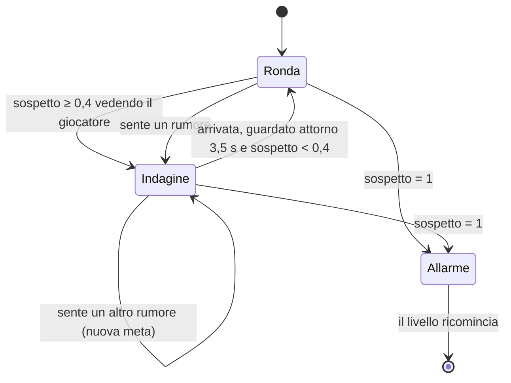

# The Pale Stitch — Technical Guide

| | |
|---|---|
| Versione del documento | 1.0 |
| Versione del software descritta | 0.0.1, commit `b5b2eec` |
| Data | 21 novembre 2026 |
| Destinatario | Ingegnere del software senza esperienza di sviluppo di videogiochi |
| Documenti collegati | [Architettura](ARCHITECTURE.md) · [Backlog](../BACKLOG.md) · [Changelog](../../CHANGELOG.md) |

## Come leggere questa guida

La guida ha tre parti, da leggere in ordine la prima volta.

- **Parte I — Fondamenti.** Che cos'è un videogioco visto dal software, come ragiona un motore di gioco, e come Godot 4 con C# traduce queste idee in nodi, scene, segnali e fisica. Non presuppone nulla oltre alla programmazione a oggetti. Ogni concetto è agganciato a un punto del nostro codice, così la teoria si verifica subito.
- **Parte II — Il progetto passo passo.** Ogni sistema di The Pale Stitch spiegato dall'interno: algoritmo, formule, esempi numerici, file e righe dove guardare.
- **Parte III — Operare sul progetto.** Ricette per le modifiche più comuni, diagnosi dei problemi, flusso di lavoro con git.

In fondo c'è un glossario. I riquadri **«Nel progetto»** indicano dove il concetto appena spiegato compare nel codice.

---

# Parte I — Fondamenti

## 1. Un videogioco visto da un ingegnere del software

### 1.1 Dal modello a eventi al ciclo continuo

Un'applicazione gestionale o un servizio web **aspetta**: arriva una richiesta o un clic, il codice reagisce, poi torna fermo. Il tempo che passa tra un evento e l'altro non conta.

Un videogioco invece **non si ferma mai**. Anche se il giocatore non tocca nulla, la guardia cammina, la torcia tremola, la nebbia scorre. Per questo il cuore di ogni gioco è un **ciclo** (game loop) che si ripete decine di volte al secondo:

```
finché il gioco è aperto:
    1. leggi l'input (tastiera, mouse, gamepad)
    2. aggiorna il mondo di un piccolo passo di tempo
    3. disegna il mondo così com'è adesso
```

Ogni giro del ciclo è un **frame**. Il numero di frame al secondo (FPS) è la frequenza del ciclo: 60 FPS significa che i tre passi vengono eseguiti 60 volte al secondo, cioè ogni 16,7 millisecondi circa.

Il tuo codice non scrive questo ciclo: lo scrive il motore. Tu fornisci delle funzioni che il motore chiama a ogni giro. È un'inversione del controllo simile a quella di un framework web: non chiami tu il server, è il server che chiama i tuoi controller.

### 1.2 Il tempo come variabile di prima classe

Il computer non garantisce che ogni frame duri esattamente lo stesso tempo. Se un frame dura 16 ms e il successivo 25 ms, un personaggio che avanza "di 5 centimetri a frame" si muoverebbe a velocità irregolare, e su un PC più veloce correrebbe di più.

La soluzione è che ogni aggiornamento riceva il **delta** (in Godot `delta`), cioè i secondi trascorsi dal frame precedente, e calcoli tutto **per unità di tempo**:

```csharp
posizione += velocità * delta;   // metri = (metri al secondo) × secondi
```

Così il movimento è lo stesso a 30, 60 o 144 FPS. Lo vedrai ovunque nel progetto: ogni metodo che aggiorna qualcosa nel tempo moltiplica per `delta` (spesso convertito in `float dt`).

### 1.3 Simulazione e rappresentazione

Conviene tenere separate due cose:

- la **simulazione**: posizioni, velocità, stati, regole (la guardia vede? il passo si sente?);
- la **rappresentazione**: ciò che compare a schermo (modelli, luci, interfaccia).

Lo schermo è solo una fotografia della simulazione in un istante. In The Pale Stitch la distinzione è esplicita: la luce che la guardia "vede" sul personaggio è un numero calcolato dalla simulazione (`LightSensor`), non il colore dei pixel. Questo rende il gioco deterministico e regolabile, ma impone di tenere allineate le due cose a mano (vedi §20).

---

## 2. Che cosa fa un motore di gioco

Un motore di gioco è un insieme di sottosistemi già pronti, coordinati dal ciclo principale. Godot 4 fornisce:

| Sottosistema | Che cosa fa | Dove lo usiamo |
|---|---|---|
| **Rendering** | Disegna il mondo 3D e l'interfaccia 2D, con luci, ombre, nebbia, materiali | Tutte le scene |
| **Fisica** | Corpi solidi, collisioni, gravità, interrogazioni geometriche (raggi) | Movimento, luce, vista, suono |
| **Input** | Tastiera, mouse, gamepad, tradotti in "azioni" con un nome | `InputActions`, Input Map |
| **Audio** | Riproduzione e mixaggio dei suoni | Non ancora usato |
| **Navigazione** | Calcolo di percorsi su una mappa camminabile | La ronda della guardia |
| **Animazione** | Interpolazioni nel tempo (tween), animazioni di scheletri | Dissolvenze, anelli di rumore |
| **Gestione scene** | Caricamento e sostituzione dei "livelli" | `SceneRouter` |
| **Risorse** | Caricamento di file (modelli, texture, font, traduzioni) con cache | Ovunque, percorsi `res://` |
| **Editor** | Ambiente visuale per costruire scene e regolare parametri | Dove passerai la maggior parte del tempo |

Il nostro lavoro consiste nel **comporre** questi sottosistemi e scrivere la logica specifica del gioco.

---

## 3. Il modello di Godot: nodi, alberi, scene

### 3.1 Il nodo

In Godot tutto ciò che esiste in gioco è un **nodo** (`Node`). Un nodo ha un nome, un tipo, delle proprietà, e può avere **figli**. I nodi formano un albero, l'**albero della scena** (SceneTree), simile al DOM di una pagina web.

I tipi di nodo sono organizzati in una gerarchia di ereditarietà. Quelli che incontrerai più spesso:

```
Node                          nodo base: logica, nessuna posizione
├── Node3D                    ha una posizione/rotazione/scala nello spazio 3D
│   ├── Camera3D              un punto di vista
│   ├── Light3D               OmniLight3D (lampadina), SpotLight3D (faretto), DirectionalLight3D (sole/luna)
│   ├── MeshInstance3D        mostra una geometria (mesh)
│   ├── Marker3D              solo un punto di riferimento, invisibile in gioco
│   ├── CollisionObject3D
│   │   ├── StaticBody3D      solido immobile (muri, pavimento)
│   │   ├── CharacterBody3D   solido mosso dal codice (giocatore, guardia)
│   │   └── Area3D            zona che rileva chi entra ed esce, non blocca
│   └── NavigationRegion3D    definisce dove si può camminare
├── CanvasItem                tutto ciò che è 2D
│   └── Control               interfaccia: Label, Button, ProgressBar, contenitori…
└── CanvasLayer               un "foglio" 2D sovrapposto alla vista 3D (l'HUD)
```

Un nodo da solo fa poco. La potenza viene dalla **composizione**: un personaggio non è una classe enorme, ma un albero di nodi specializzati (corpo fisico + forma di collisione + modello + camera + sensore).

> **Nel progetto.** Apri `scenes/player/Player.tscn`: il giocatore è un `CharacterBody3D` con figli `CollisionShape3D` (la capsula che urta), `Visual` (il modello), `Head/FirstPersonCamera` (gli occhi), `LightSensor` e `InteractProbe` (un'`Area3D` che rileva gli oggetti vicini). L'albero completo è nell'[Architettura §7](ARCHITECTURE.md#7-composizione-delle-scene).

### 3.2 La scena

Una **scena** è un albero di nodi salvato su file (`.tscn`). Una scena si può **istanziare** dentro un'altra scena, anche molte volte: è l'equivalente di una classe con i suoi oggetti, o di un componente riutilizzabile.

In Godot non c'è distinzione tra "livello", "prefabbricato" e "componente": sono tutte scene. Il prologo è una scena che contiene un'istanza della scena del giocatore, una della guardia e una dell'HUD.

Il file `.tscn` è testo leggibile. Un estratto di `Player.tscn`:

```ini
[node name="Player" type="CharacterBody3D"]
collision_layer = 2
script = ExtResource("1_player")

[node name="Head" type="Marker3D" parent="."]
transform = Transform3D(1, 0, 0, 0, 1, 0, 0, 0, 1, 0, 1.6, 0)
```

Si può leggere e confrontare con git, ma va modificato dall'editor: gli identificativi interni sono facili da rompere a mano.

### 3.3 Lo script

Un nodo ottiene un comportamento proprio quando gli si **attacca uno script**: una classe C# che **eredita dal tipo del nodo**. `PlayerController` eredita da `CharacterBody3D`, quindi *è* un corpo fisico, con in più la nostra logica.

```csharp
public partial class PlayerController : CharacterBody3D
{
    // proprietà, metodi del ciclo di vita, logica
}
```

Ogni nodo può avere al massimo uno script. Per aggiungere comportamenti si aggiungono nodi figli con il loro script (è così che `LightSensor` è un nodo a parte, figlio del giocatore).

### 3.4 Risorse e percorsi

Una **risorsa** (`Resource`) è un dato condiviso, non un oggetto vivo nell'albero: una mesh, un materiale, una texture, un font, un tema, un file di traduzione. Le risorse si salvano in `.tres` (testo) o nei formati originali (`.ttf`, `.png`) con un file `.import` accanto.

Godot usa due radici di percorso:

| Prefisso | Che cosa indica | Esempio |
|---|---|---|
| `res://` | La cartella del progetto (sola lettura nel gioco esportato) | `res://scenes/player/Player.tscn` |
| `user://` | Una cartella scrivibile dell'utente, per salvataggi e impostazioni | `user://settings.cfg` → su Windows `%APPDATA%\Godot\app_userdata\The Pale Stitch\` |

---

## 4. Il ciclo di vita di un nodo

Godot chiama metodi precisi del tuo script in momenti precisi. Si riconoscono dal trattino basso iniziale e si implementano con `override`.

| Metodo | Quando viene chiamato | Uso tipico |
|---|---|---|
| `_EnterTree()` | Il nodo è appena entrato nell'albero (dall'alto verso il basso: prima il padre, poi i figli) | Registrarsi in un singleton o a un evento |
| `_Ready()` | Il nodo **e tutti i suoi figli** sono nell'albero (dal basso verso l'alto: prima i figli) | Cercare i nodi figli, inizializzare |
| `_Process(double delta)` | A ogni frame disegnato | Interfaccia, effetti visivi, logica non fisica |
| `_PhysicsProcess(double delta)` | A ogni passo della fisica, a frequenza fissa (60 al secondo) | Movimento, collisioni, raycast, IA |
| `_UnhandledInput(InputEvent e)` | Un evento di input non è stato consumato dall'interfaccia | Comandi di gioco |
| `_ExitTree()` | Il nodo sta uscendo dall'albero | Disiscriversi dagli eventi |
| `_Draw()` | Un `Control` o `CanvasItem` va ridisegnato (dopo `QueueRedraw()`) | Disegno 2D personalizzato |

Il motivo dell'ordine di `_Ready` è pratico: quando il padre è pronto, può contare sul fatto che i figli siano già pronti.

Per distruggere un nodo si chiama `QueueFree()`: il nodo viene rimosso alla fine del frame, non subito, così il codice in esecuzione non si trova un oggetto sparito a metà.

> **Nel progetto.** `Watchman` si iscrive ai rumori in `_EnterTree` e si disiscrive in `_ExitTree` (`scripts/ai/Watchman.cs`, righe 62–63). `PlayerController._Ready` cerca i propri figli (`GetNode<Node3D>("Head")`, righe 72–83). Il movimento sta in `_PhysicsProcess`, l'aggiornamento dell'HUD in `_Process`.

---

## 5. Il tempo nel codice

### 5.1 Due orologi

Godot ha due orologi distinti:

| | `_Process` | `_PhysicsProcess` |
|---|---|---|
| Frequenza | Variabile, segue il monitor (60, 144…) | Fissa, 60 Hz di default |
| `delta` | Varia da frame a frame | Sempre circa 1/60 s |
| Per cosa | Ciò che si vede | Ciò che si simula |

La fisica a passo fisso rende la simulazione stabile e riproducibile: una collisione si comporta allo stesso modo su ogni PC.

### 5.2 Muovere verso un obiettivo: MoveToward

```csharp
velocity.X = Mathf.MoveToward(velocity.X, wanted.X, Acceleration * dt);
```

`MoveToward(da, a, passo)` avvicina `da` ad `a` di al massimo `passo`, senza superarlo. Con `Acceleration = 14` m/s² il personaggio passa da fermo a 3,2 m/s in circa 0,23 secondi: l'accelerazione è lineare e indipendente dagli FPS.

### 5.3 Lo smorzamento esponenziale: `1 - exp(-k·dt)`

Questa espressione compare in tutto il progetto e conviene capirla una volta per tutte:

```csharp
GlobalPosition = GlobalPosition.Lerp(target, 1f - Mathf.Exp(-FollowSpeed * dt));
```

`Lerp(a, b, t)` restituisce il punto che sta alla frazione `t` del segmento da `a` a `b` (`t = 0` → `a`, `t = 1` → `b`). Se usassimo un `t` fisso, ad esempio 0,1, la camera si avvicinerebbe del 10 % a ogni frame: a 144 FPS raggiungerebbe il bersaglio molto prima che a 30 FPS.

Con `t = 1 − e^(−k·dt)` la frazione dipende dal tempo trascorso. Dopo un tempo totale `T`, qualunque sia il numero di frame, la distanza residua è sempre `e^(−k·T)` volte quella iniziale. Il parametro `k` si legge così: **dopo 1/k secondi resta il 37 % della distanza, dopo 3/k secondi il 5 %**.

| Dove | `k` | Significato pratico |
|---|---|---|
| `CameraRig`, inseguimento | 6 | Raggiunge il giocatore in circa mezzo secondo |
| `CameraRig`, rotazione | 8 | Una rotazione di 90° si assesta in circa 0,4 s |
| `PlayerController`, orientamento del corpo | 12 | Il corpo si gira verso la direzione di marcia in circa 0,25 s |
| `LightSensor`, esposizione | 6 | L'occhio dell'HUD non sfarfalla quando una torcia tremola |
| `Watchman`, rotazione | 6 | La guardia si volta con naturalezza |

### 5.4 Interpolazioni programmate: i Tween

Per animare una proprietà da un valore a un altro in un tempo dato, Godot offre i **Tween**:

```csharp
CreateTween().TweenProperty(notice, "modulate:a", 1f, 1.2f);
```

Significa: porta la proprietà `modulate:a` (l'opacità) del nodo `notice` a 1 in 1,2 secondi. Il tween si aggiorna da solo a ogni frame e si distrugge alla fine. Si possono concatenare (`Chain()`), eseguire in parallelo (`SetParallel()`), scegliere la curva (`SetTrans`, `SetEase`) e attendere la fine (`await ToSignal(tween, Tween.SignalName.Finished)`).

> **Nel progetto.** Dissolvenze di `SceneRouter`, comparsa della scritta in `Boot`, anelli di rumore in `NoiseRingSpawner`, cucitura animata in `StitchLine`.

---

## 6. Lo spazio 3D

### 6.1 Assi e unità

| Asse | Direzione in Godot |
|---|---|
| +X | destra |
| +Y | **alto** |
| −Z | **avanti** (la direzione in cui guarda una camera o un personaggio) |

L'unità di misura è il **metro**. Il giocatore è alto 1,7 m, i suoi occhi sono a 1,6 m, le case del prologo sono alte 5–7 m.

### 6.2 Trasformazioni locali e globali

Ogni `Node3D` ha una **trasformazione** (`Transform3D`): posizione (`Origin`) più una matrice 3×3 (`Basis`) che codifica rotazione e scala. La trasformazione è **relativa al padre**:

- `Position`, `Rotation`: rispetto al nodo padre;
- `GlobalPosition`, `GlobalBasis`: rispetto al mondo.

Se muovi il padre, i figli lo seguono. È per questo che la camera in prima persona, figlia di `Head`, segue la testa, che è figlia del giocatore.

Le colonne della `Basis` sono gli assi locali del nodo espressi nel mondo. In particolare `-GlobalBasis.Z` è la direzione "avanti" del nodo.

> **Nel progetto.** `Watchman.Sight` usa `Vector3 forward = -GlobalBasis.Z;` per sapere dove guarda la guardia.

### 6.3 Le operazioni sui vettori che userai

| Operazione | Significato | Esempio nel progetto |
|---|---|---|
| `b - a` | Vettore che va da `a` a `b` | `Vector3 to = target - eyes;` |
| `v.Length()` | Lunghezza (distanza) | `float distance = to.Length();` |
| `v.Normalized()` | Stessa direzione, lunghezza 1 | direzione di marcia della guardia |
| `a.DistanceTo(b)` | Distanza tra due punti | falloff della luce |
| `a.AngleTo(b)` | Angolo tra due direzioni, in radianti | cono visivo della guardia |
| `a.Lerp(b, t)` | Interpolazione lineare | camera, posizioni del video |
| `v.Rotated(asse, angolo)` | Ruota il vettore | input reso relativo alla camera |
| `Mathf.Atan2(y, x)` | Angolo di un vettore 2D | orientare un personaggio verso la direzione di marcia |

### 6.4 Rotazioni: yaw e pitch

Per i personaggi bastano due angoli:

- **yaw**: rotazione attorno all'asse Y (girarsi a destra e a sinistra);
- **pitch**: rotazione attorno all'asse X (guardare in alto e in basso).

Per far guardare un nodo nella direzione di un vettore orizzontale `(x, z)` si calcola lo yaw così:

```csharp
float yaw = Mathf.Atan2(-direction.X, -direction.Z);
```

I segni meno derivano dal fatto che "avanti" è −Z: con yaw = 0 il nodo guarda verso −Z, e la formula trova l'angolo che porta −Z a coincidere con la direzione voluta.

---

## 7. Fisica

### 7.1 I tre tipi di corpo che usiamo

| Tipo | Si muove? | Blocca? | Uso nel progetto |
|---|---|---|---|
| `StaticBody3D` | No | Sì | Terreno, case, muri, carro, casse |
| `CharacterBody3D` | Sì, solo da codice | Sì | Giocatore, guardia |
| `Area3D` | Può | No, **rileva** | Zone di superficie, sonda di interazione, porta |

Ogni corpo ha bisogno di una o più **forme di collisione** figlie (`CollisionShape3D` con una capsula, un box, una sfera). La forma è invisibile: è la geometria che il motore usa per i calcoli, quasi sempre più semplice del modello visibile.

Un `CharacterBody3D` si muove impostando `Velocity` e chiamando `MoveAndSlide()`: il motore sposta il corpo, lo fa scivolare lungo i muri invece di fermarlo, e aggiorna `IsOnFloor()`.

### 7.2 Layer e maschere: un filtro a bit

Non tutti gli oggetti devono interagire con tutti. Godot usa due campi di 32 bit:

- `collision_layer`: **su quali layer sto io**;
- `collision_mask`: **quali layer guardo io**.

A rileva B se il layer di B ha almeno un bit in comune con la maschera di A. I layer si numerano da 1, ma nel file il valore è una **somma di potenze di 2**: layer 1 = 1, layer 2 = 2, layer 3 = 4, layer 4 = 8, layer 5 = 16. Una maschera che vede i layer 1 e 3 vale 1 + 4 = 5.

> **Nel progetto.** La tabella completa è nell'[Architettura §8](ARCHITECTURE.md#8-fisica-layer-e-maschere). Esempio: le `SurfaceZone` stanno sul layer 5 (valore 16) e guardano il layer 2 (valore 2): rilevano solo il giocatore. Il giocatore ha maschera 1 e la guardia è sul layer 3: per questo oggi il giocatore la attraversa (FIX-001).

### 7.3 Il raycast: la domanda più usata del gioco

Un **raycast** chiede al motore fisico: «il segmento da A a B tocca qualcosa?». La risposta dice cosa ha colpito, dove e con quale normale.

```csharp
var query = PhysicsRayQueryParameters3D.Create(from, to, mask, exclude);
var hit = GetWorld3D().DirectSpaceState.IntersectRay(query);
bool bloccato = hit.Count > 0;
```

- `mask`: quali layer considerare (noi usiamo solo il layer 1, i muri);
- `exclude`: corpi da ignorare (ad esempio il corpo stesso di chi guarda).

Tutta la furtività del progetto si basa su questa domanda:

| Domanda di gioco | Raycast |
|---|---|
| La luce di quella torcia arriva al personaggio? | Dal personaggio alla torcia |
| La guardia vede il personaggio? | Dagli occhi della guardia al petto del personaggio |
| Il rumore attraversa dei muri? | Dalla sorgente del rumore alla guardia, contando i muri |

I raycast vanno fatti preferibilmente dentro `_PhysicsProcess`: è il momento in cui il mondo fisico è coerente (vedi FIX-007).

---

## 8. Comunicazione tra nodi e input

### 8.1 Trovare un nodo

| Metodo | Esempio | Quando usarlo |
|---|---|---|
| Percorso relativo | `GetNode<Camera3D>("Head/FirstPersonCamera")` | Figli noti di una scena che possiedi |
| Nome unico `%` | `GetNode<Label>("%Hint")` | Nodi profondi di una scena di interfaccia; il nome è unico nella scena e il percorso può cambiare senza rompere il codice |
| `NodePath` esportato | `[Export] public NodePath PlayerPath;` | Collegamenti tra scene diverse, impostati nell'Inspector |
| Gruppo | `GetTree().GetFirstNodeInGroup("player")` | Trovare "il giocatore" o "tutte le guardie" senza sapere dove sono |

Il segno `%` funziona solo per i nodi marcati come *Access as Unique Name* nell'editor (nel file: `unique_name_in_owner = true`).

### 8.2 Segnali

Un **segnale** è un evento dichiarato da un nodo, a cui altri si collegano. È il pattern Observer del motore.

```csharp
// dichiarazione, in Interactable.cs
[Signal] public delegate void InteractedEventHandler(Node3D who);

// emissione
EmitSignal(SignalName.Interacted, who);

// iscrizione, in PrologueLevel.cs
_door.Interacted += OnDoorUsed;
```

Il nome del delegato deve finire con `EventHandler`: Godot genera l'evento C# `Interacted` togliendo il suffisso. I segnali si possono collegare anche dall'editor (pannello Nodo → Segnali). Molti nodi hanno segnali predefiniti: `Button.Pressed`, `Area3D.BodyEntered`, `Tween.Finished`.

### 8.3 Gruppi

Un nodo può appartenere a uno o più gruppi, che sono semplici etichette:

```csharp
AddToGroup("guards");
foreach (Node n in GetTree().GetNodesInGroup("guards")) { ... }
```

I gruppi si assegnano anche nell'editor (pannello Nodo → Gruppi): le torce del prologo stanno nel gruppo `stealth_light` impostato direttamente nella scena.

### 8.4 Autoload (singleton)

Un **autoload** è una scena o uno script che Godot crea all'avvio e mette sotto la radice, prima di qualsiasi altra scena. Non viene mai distrutto dai cambi di scena. Si configura in Progetto → Impostazioni progetto → Globali → Autoload.

Il nostro progetto ne ha due, `GameState` e `SceneRouter`, ed espone l'istanza con una proprietà statica:

```csharp
public static GameState Instance { get; private set; }
public override void _EnterTree() => Instance = this;
```

### 8.5 Input: azioni invece di tasti

Il codice non controlla mai un tasto specifico. Chiede lo stato di un'**azione** con un nome, e la **Input Map** (Progetto → Impostazioni progetto → Mappa input) associa a ogni azione uno o più tasti. Così si possono cambiare i comandi senza toccare il codice, e aggiungere un gamepad in seguito.

| Azione | Tasti | Usata da |
|---|---|---|
| `move_forward`, `move_back`, `move_left`, `move_right` | WASD, frecce | `PlayerController`; `move_back` esce anche dalla serratura |
| `sneak` | Ctrl, C | `PlayerController` |
| `run` | Shift | `PlayerController` |
| `interact` | E | `PlayerController`, `PrologueLevel` |
| `camera_rotate_left`, `camera_rotate_right` | Q, R | `CameraRig` |
| `toggle_view` | V | `CameraRig` |
| `pause` | Esc | `PauseMenu` |
| `skip` | Spazio, Invio, Esc | `Boot`, `IntroCinematic` |

Le domande più comuni all'input:

```csharp
Input.IsActionPressed("run")            // è tenuto premuto adesso?
Input.IsActionJustPressed("move_back")  // è stato premuto in questo frame?
Input.GetVector(left, right, up, down)  // vettore 2D di movimento, lunghezza massima 1
@event.IsActionPressed("interact")      // dentro _UnhandledInput: questo evento è la pressione di interact?
```

Il primo e il terzo **interrogano lo stato**; il quarto **reagisce a un evento**. Si usa lo stato per azioni continue (camminare, tenere premuto per scassinare), l'evento per azioni puntuali (aprire la pausa, ruotare la camera).

> **Nel progetto.** I nomi delle azioni sono raccolti in `scripts/core/InputActions.cs` come `StringName` statici: un errore di battitura diventa un errore di compilazione invece di un tasto che non risponde.

---

## 9. Godot con C# e .NET

### 9.1 Classi `partial` e generatori di codice

Ogni classe che eredita da un tipo Godot deve essere `partial`. Al momento della compilazione i **generatori di codice** di Godot (`Godot.SourceGenerators`) scrivono l'altra metà della classe: il codice che fa vedere al motore le proprietà esportate, i segnali e i metodi. Senza `partial` la compilazione fallisce.

### 9.2 `[Export]`: parametri regolabili dall'editor

```csharp
[Export] public float WalkSpeed = 3.2f;
```

Una proprietà o un campo con `[Export]` compare nell'**Inspector** quando selezioni il nodo, e il valore impostato lì viene salvato nella scena. Il valore nel codice è solo il default. È il modo con cui un game designer bilancia il gioco senza programmare.

`[ExportGroup("…")]` raggruppa le voci nell'Inspector; `[Export(PropertyHint.Range, "0,1")]` mostra un cursore.

> Attenzione: se un valore è stato cambiato nell'Inspector, modificare il default nel codice **non** cambia quella scena. Il valore salvato nella scena vince.

### 9.3 Tipi del motore e tipi .NET

| Godot | .NET | Note |
|---|---|---|
| `StringName` | `string` | Stringa "internata", confronti velocissimi; usata per nomi di azioni, segnali, gruppi |
| `NodePath` | `string` | Percorso verso un nodo |
| `Variant` | `object` | Valore generico del motore (dizionari, impostazioni). Si converte con `.AsString()`, `.AsBool()`, `.AsRid()` |
| `Godot.Collections.Array<T>`, `Dictionary` | `List<T>`, `Dictionary<K,V>` | Le collezioni Godot servono quando si passano dati al motore; per la logica interna si usano quelle .NET |
| `Vector3`, `Color`, `Transform3D` | — | `struct` di valore: si copiano, non si condividono |

Conseguenza pratica dell'ultima riga: `Velocity.X = 5;` non compila, perché `Velocity` restituisce una copia. Si scrive:

```csharp
Vector3 velocity = Velocity;
velocity.X = 5f;
Velocity = velocity;
```

### 9.4 Durata degli oggetti

Un nodo Godot ha due vite: quella dell'oggetto C# e quella dell'oggetto nativo del motore. Dopo `QueueFree()` l'oggetto nativo sparisce, ma il riferimento C# può restare in giro; usarlo genera `ObjectDisposedException`. Regole:

- disiscriversi dagli eventi C# in `_ExitTree`;
- per sapere se un riferimento è ancora buono: `GodotObject.IsInstanceValid(obj)`;
- non conservare riferimenti a nodi di una scena in oggetti statici o negli autoload.

### 9.5 `async` e `await` con i segnali

`ToSignal(oggetto, segnale)` restituisce un oggetto attendibile con `await`. Permette di scrivere sequenze nel tempo in modo lineare:

```csharp
var fadeOut = CreateTween();
fadeOut.TweenProperty(_fade, "modulate:a", 1.0f, fadeSeconds);
await ToSignal(fadeOut, Tween.SignalName.Finished);   // riprende quando il tween finisce
GetTree().ChangeSceneToFile(scenePath);
```

Il codice dopo `await` riprende sul thread principale del motore, quindi può toccare i nodi in sicurezza.

### 9.6 Compilazione e versioni del .NET SDK

Prima di eseguire il gioco, Godot compila tutto il C# del progetto in una DLL. La catena:

1. `The Pale Stitch.csproj` dichiara l'SDK `Godot.NET.Sdk/4.7.2` e il framework `net8.0`.
2. `dotnet build` scarica da NuGet i pacchetti di Godot, esegue i generatori, compila.
3. La DLL finisce in `.godot/mono/temp/bin/Debug/The Pale Stitch.dll`.
4. L'editor e il gioco caricano quella DLL.

Due versioni diverse entrano in gioco, ed è facile confonderle:

| Che cosa | Versione | Perché |
|---|---|---|
| **.NET SDK** installato sul PC | **10** | L'editor di Godot 4.7.2 rifiuta di compilare senza un SDK 10 (errore *.NET Sdk not found. The required version is '10.0.x'*) |
| **Framework di destinazione** nel `.csproj` | `net8.0` | È il minimo supportato dalle librerie di Godot; l'SDK 10 sa compilare per .NET 8 e il gioco gira sul runtime più recente installato |

Se la compilazione fallisce, l'editor mostra comunque le scene, ma gli script non sono collegati: gli autoload non partono (*Failed to create an autoload, script … is not compiling*) e nulla si muove.

---

## 10. L'editor di Godot

### 10.1 I pannelli che userai

| Pannello | Posizione di default | A che cosa serve |
|---|---|---|
| **Scena** | in alto a sinistra | L'albero dei nodi della scena aperta |
| **FileSystem** | in basso a sinistra | I file del progetto (`res://`) |
| **Viewport** | al centro | La vista 2D o 3D della scena; schede 2D / 3D / Script in alto |
| **Inspector** | a destra | Le proprietà del nodo selezionato, comprese quelle `[Export]` |
| **Nodo** | a destra, accanto all'Inspector | Segnali e gruppi del nodo selezionato |
| **Output** | in basso | Messaggi, avvisi ed errori del motore e di `GD.Print` |
| **Debugger** | in basso | Errori a runtime con stack, profiler, monitor, variabili |
| **MSBuild** | in basso | Esito della compilazione C# |

### 10.2 Eseguire

| Tasto | Che cosa esegue |
|---|---|
| **F5** | Il gioco dalla scena principale (`Boot.tscn`) |
| **F6** | Solo la scena aperta nell'editor (per provare il prologo saltando menu e video) |
| **F8** | Ferma il gioco |
| Martello in alto a destra | Compila il C# senza eseguire |

### 10.3 Ispezionare il gioco mentre gira

Con il gioco avviato dall'editor, nel pannello Scena compare la scheda **Remoto**: è l'albero dei nodi **del gioco in esecuzione**. Selezionando un nodo, l'Inspector mostra i valori in tempo reale e permette di modificarli al volo. Per esempio, seleziona `Watchman` e osserva `Suspicion` mentre ti fai vedere. È lo strumento più utile per capire cosa succede.

---

## 11. Rendering essenziale

### 11.1 Camere: prospettiva e ortografica

| Proiezione | Come appare | Parametro di zoom | Uso nel progetto |
|---|---|---|---|
| Prospettica | Gli oggetti lontani sono più piccoli, come l'occhio umano | `Fov` (campo visivo, gradi) | Prima persona, video iniziale |
| Ortografica | Le dimensioni non dipendono dalla distanza; linee parallele restano parallele | `Size` (altezza inquadrata, metri) | Vista isometrica di gioco |

La vista "isometrica" del gioco è una camera ortografica inclinata di 35° verso il basso e ruotata di 45°: la tipica vista a volo d'uccello dei giochi tattici.

Può esserci una sola camera attiva per finestra: si attiva con `MakeCurrent()`. Passare dalla vista isometrica alla prima persona significa attivare l'altra camera.

### 11.2 Luci

| Tipo | Come una… | Parametri chiave |
|---|---|---|
| `OmniLight3D` | lampadina, torcia, candela | `LightEnergy` (intensità), `OmniRange` (raggio in metri), colore |
| `SpotLight3D` | faretto, lanterna schermata | in più `SpotAngle` (semi-apertura del cono, gradi) |
| `DirectionalLight3D` | sole o luna | solo direzione ed energia; illumina tutto con raggi paralleli |

`shadow_enabled` attiva le ombre di quella luce: costano, quindi si attivano solo dove servono.

### 11.3 Ambiente, materiali, mesh

- **WorldEnvironment** definisce colore di sfondo, luce ambiente, nebbia, glow (bagliore attorno alle luci forti) e tonemapping (come i valori di luce diventano colori a schermo).
- Una **mesh** è la geometria (triangoli). Le mesh primitive (`BoxMesh`, `CapsuleMesh`, `CylinderMesh`) bastano per la graybox.
- Un **materiale** dice come la superficie riflette la luce: colore (`AlbedoColor`), ruvidità (`Roughness`), metallicità, emissione (luce propria).

### 11.4 Shader

Uno **shader** è un piccolo programma eseguito dalla scheda video per ogni pixel (fragment) o vertice. In Godot si scrive in un linguaggio simile al GLSL, in file `.gdshader`. Il progetto ne usa due, entrambi per l'interfaccia 2D (`shader_type canvas_item`). Sono spiegati al §25.

---

## 12. Interfaccia utente e localizzazione

### 12.1 I Control e il layout

I nodi dell'interfaccia derivano da `Control`. Due modi di posizionarli:

- **Ancore e offset**: ogni lato del controllo è agganciato a una frazione del padre (0 = sinistra/alto, 1 = destra/basso) più uno scostamento in pixel. `anchor_left = 0.5` con `offset_left = -230` significa: 230 pixel a sinistra del centro.
- **Contenitori**: `VBoxContainer` impila i figli in verticale, `HBoxContainer` in orizzontale, `MarginContainer` aggiunge margini, `PanelContainer` disegna uno sfondo. I figli di un contenitore si dispongono da soli.

Un `CanvasLayer` è un livello 2D disegnato sopra la vista 3D, indipendente dalla camera: l'HUD e la dissolvenza di `SceneRouter` vivono in `CanvasLayer`.

### 12.2 Il tema

Un **Theme** (`.tres`) definisce colori, font, dimensioni e sfondi di tutti i controlli. Impostato in `project.godot` come tema di progetto, si applica ovunque senza toccare le singole scene. Le **variazioni di tipo** (`theme_type_variation`) sono stili alternativi con un nome: `TitleLabel`, `HintLabel`, `PerkLabel`, `FaintLabel` nel nostro tema.

### 12.3 La localizzazione

I testi non si scrivono mai nell'interfaccia: si scrive una **chiave**.

1. In `localization/strings.csv` ogni riga è `CHIAVE,testo inglese,testo italiano`.
2. Godot importa il CSV e genera un file `.translation` per lingua.
3. `project.godot` registra i due file.
4. Ogni `Label` e `Button` con testo uguale a una chiave mostra **automaticamente** la traduzione della lingua attiva (*auto-translate*).
5. Nel codice, `Tr("CHIAVE")` restituisce il testo tradotto.
6. `TranslationServer.SetLocale("it")` cambia lingua: tutta l'interfaccia si aggiorna da sola.

Quando un testo è composto nel codice (ad esempio *"Visibilità: −20%"*) va tradotto con `Tr()` e il controllo va escluso dall'auto-traduzione (`AutoTranslateMode = Disabled`), altrimenti Godot proverebbe a cercare la frase intera come chiave.

---

# Parte II — Il progetto passo passo

Ogni capitolo segue lo stesso schema: **a che cosa serve**, **dove sta il codice**, **l'algoritmo passo per passo**, **un esempio con i numeri**, **cosa regolare**. I numeri di riga si riferiscono al commit `b5b2eec`.

## 13. Avvio e cambi di scena

**Codice:** `scripts/intro/Boot.cs`, `scripts/core/SceneRouter.cs`. **Scena:** `scenes/boot/Boot.tscn`.

### 13.1 Che cosa succede quando premi F5

1. Godot legge `project.godot`.
2. Crea gli autoload `GameState` e `SceneRouter`. `GameState._EnterTree` legge le impostazioni e imposta la lingua (§14).
3. Carica `Boot.tscn` e chiama `Boot._Ready`:
   - porta a 0 l'opacità della scritta e avvia un tween che la fa comparire in 1,2 s;
   - crea un timer di 3,5 s (`Seconds`) che chiamerà `Leave()`.
4. Se il giocatore preme Spazio, Invio o Esc prima della fine, `_UnhandledInput` chiama `Leave()` subito.
5. `Leave()` sceglie la destinazione: video iniziale se `GameState.IntroSeen` è falso, altrimenti menu.

`Leave()` può essere chiamato due volte (timer e tasto). Il campo `_leaving` fa sì che abbia effetto una volta sola. Il controllo su `_leaving` viene **prima** di qualsiasi chiamata al motore: quando il timer scatta dopo che la scena è già stata distrutta, il metodo esce senza toccare un nodo non più valido.

### 13.2 `SceneRouter.GoTo`: la dissolvenza

`SceneRouter` è un `CanvasLayer` con `Layer = 100`, quindi disegnato sopra tutto, e `ProcessMode = Always`, quindi funziona anche a gioco in pausa. In `_Ready` crea da codice un `ColorRect` nero a tutto schermo, trasparente.

`GoTo(scenePath, fadeSeconds = 0.7f)`, passo per passo:

| Passo | Codice | Effetto |
|---|---|---|
| 1 | `if (_busy) return;` | Una transizione alla volta |
| 2 | `_fade.MouseFilter = Stop` | Durante la dissolvenza i clic non arrivano alla scena sotto |
| 3 | tween di `modulate:a` da 0 a 1, poi `await` | Lo schermo diventa nero |
| 4 | `GetTree().Paused = false`, mouse visibile | Ripulisce lo stato lasciato dalla scena precedente (pausa, mouse catturato in prima persona) |
| 5 | `ChangeSceneToFile(scenePath)` | Godot libera la scena vecchia e carica la nuova (alla fine del frame) |
| 6 | due `await` di `ProcessFrame` | Lascia alla nuova scena il tempo di eseguire `_Ready` e posizionarsi |
| 7 | tween da 1 a 0, poi `await` | Lo schermo torna visibile |
| 8 | `_busy = false` | Pronto per la prossima transizione |

Il metodo è `async void`: chi lo chiama prosegue subito. Difetti noti: una richiesta durante una transizione viene persa, e un'eccezione dentro il metodo non arriva a nessuno (FIX-008).

---

## 14. Stato globale e impostazioni

**Codice:** `scripts/core/GameState.cs`.

`GameState` tiene tre informazioni:

| Proprietà | Persistita? | Scritta da |
|---|---|---|
| `Profile` (personaggio) | No, solo in memoria | `CharacterCreation.GoNext` tramite `CommitProfile` |
| `Locale` (lingua) | Sì | `MainMenu` tramite `SetLocale` |
| `IntroSeen` | Sì | `IntroCinematic.Leave` tramite `MarkIntroSeen` |

Le impostazioni usano `ConfigFile`, il formato INI di Godot:

```csharp
var cfg = new ConfigFile();
if (cfg.Load("user://settings.cfg") == Error.Ok)
    Locale = cfg.GetValue("game", "locale", DefaultLocale()).AsString();
```

Al primo avvio il file non esiste: la lingua viene presa dal sistema operativo (`OS.GetLocaleLanguage()`), italiano se il sistema è in italiano, altrimenti inglese.

Per rivedere il video iniziale al prossimo avvio, cancella `%APPDATA%\Godot\app_userdata\The Pale Stitch\settings.cfg`, oppure usa "Rivedi l'apertura" dal menu.

`Profile` parte con un personaggio di default (`CharacterProfile.Default()`). È per questo che con F6 sul prologo si gioca comunque, con il primo mestiere, il primo costume e il primo volto.

---

## 15. I testi nel progetto

**File:** `localization/strings.csv` (128 chiavi, colonne `keys,en,it`).

Le chiavi seguono prefissi per area:

| Prefisso | Area | Esempio |
|---|---|---|
| `GAME_`, `BOOT_`, `MENU_` | Titolo, avvio, menu | `MENU_NEW` |
| `INTRO_` | Video iniziale (cartelli `CARD`, narrazione `VO`) | `INTRO_VO_3` |
| `CC_`, `MOD_` | Creazione personaggio, modificatori | `CC_BEGIN`, `MOD_SEEN` |
| `SKILL_` | Abilità e loro spiegazione (`_HINT`) | `SKILL_TREAD_HINT` |
| `TRADE_`, `COSTUME_`, `VARIANT_`, `VISAGE_`, `ALIAS_` | Catalogo del personaggio, derivate dall'Id | `TRADE_POISONER_PERK` |
| `STANCE_`, `SURFACE_`, `HUD_`, `PROMPT_` | Schermata di gioco | `SURFACE_GRAVEL` |
| `PROLOGUE_`, `HINT_`, `CAUGHT_` | Prologo e tutorial | `HINT_BELL` |
| `PAUSE_` | Menu di pausa | `PAUSE_RESUME` |

Le chiavi del catalogo non sono scritte nel codice ma **calcolate**: `TradeDef.NameKey` restituisce `$"TRADE_{Id.ToUpperInvariant()}_NAME"`. Se aggiungi un mestiere con Id `fence`, servono le chiavi `TRADE_FENCE_NAME`, `TRADE_FENCE_DESC`, `TRADE_FENCE_PERK`, `TRADE_FENCE_PERK_DESC`. Una chiave mancante compare a schermo così com'è (`TRADE_FENCE_NAME`), il che rende l'errore facile da vedere.

Il CSV va salvato in UTF-8. I testi che contengono virgole vanno tra virgolette doppie.

---

## 16. Il video iniziale

**Codice:** `scripts/intro/IntroCinematic.cs`, `scripts/intro/IntroShot.cs`. **Scena:** `scenes/intro/IntroCinematic.tscn`.

### 16.1 Struttura

La scena contiene:

- un **set** di blocchi (città, forca, tavolo con la candela, cadavere, cripta), illuminato e immerso nella nebbia volumetrica;
- un'unica `Camera3D`;
- un nodo `Shots` con cinque figli `IntroShot`, in ordine di esecuzione;
- un `CanvasLayer` `Overlay` con nero, bande del formato cinema, cartello, sottotitolo, cucitura e titolo.

Ogni `IntroShot` ha quattro `Marker3D` figli: `CamFrom`, `CamTo` (dove si trova la camera all'inizio e alla fine), `LookFrom`, `LookTo` (dove guarda all'inizio e alla fine). Le proprietà `Duration`, `Fov`, `SubtitleKey`, `CardKey` si regolano nell'Inspector.

### 16.2 L'algoritmo, a ogni frame

```
t      = tempo_nell_inquadratura / durata          (da 0 a 1)
eased  = SmoothStep(0, 1, t) = 3t² − 2t³           (parte e arriva dolcemente)
camera.posizione = Lerp(CamFrom, CamTo, eased)
camera.guarda    = Lerp(LookFrom, LookTo, eased)
```

`SmoothStep` evita che la camera parta e si fermi di colpo: la velocità è nulla agli estremi e massima a metà.

Le dissolvenze usano una funzione a **trapezio**:

```csharp
Window(daInizio, allaFine, rampa) = clamp(min(daInizio, allaFine) / rampa, 0, 1)
```

Vale 0 agli estremi, sale linearmente in `rampa` secondi, resta a 1 nel mezzo. Applicata a tre elementi:

| Elemento | Chiamata | Effetto |
|---|---|---|
| Nero | `1 − Window(t, durata − t, 1,2)` | Ogni inquadratura entra ed esce dal nero in 1,2 s |
| Sottotitolo | `Window(t − 1,5, durata − t − 1,2, 0,8)` | Compare 1,5 s dopo l'inizio, sparisce prima del nero |
| Cartello | `Window(t − 0,8, 5 − t, 0,8)` | Visibile tra 0,8 e 5 s (solo la prima inquadratura ne ha uno) |

Esaurite le inquadrature parte la **fase del titolo** (8 s): la cucitura si chiude tra 0,5 e 3,5 s (`StitchLine.Progress`), il titolo compare tra 2,5 e 4,5 s. Poi `Leave()` segna il video come visto e va al menu.

| Inquadratura | Durata | Fov |
|---|---|---|
| 1 — Ago e candela | 13 s | 38° |
| 2 — Tetti | 13 s | 45° |
| 3 — Forca | 13 s | 50° |
| 4 — Bocca cucita | 14 s | 40° |
| 5 — Porta della cripta | 13 s | 55° |
| Titolo | 8 s | — |
| **Totale** | **74 s** | |

### 16.3 Modificare il film

- **Riquadrare:** seleziona i marcatori di un'inquadratura e spostali nella vista 3D. Per vedere cosa inquadra la camera, seleziona `Camera` e attiva l'anteprima della camera nella vista 3D.
- **Riordinare:** trascina gli `IntroShot` sotto `Shots`; l'ordine dei figli è l'ordine di esecuzione.
- **Aggiungere:** duplica un `IntroShot` (Ctrl+D), sposta i marcatori, imposta una nuova chiave `INTRO_VO_n` nel CSV.

---

## 17. La creazione del personaggio

**Codice:** `scripts/character/CharacterCatalog.cs`, `CharacterProfile.cs`, `scripts/ui/CharacterCreation.cs`, `PortraitCard.cs`, `PipBar.cs`. **Scena:** `scenes/character/CharacterCreation.tscn`.

### 17.1 Il modello dei dati

Il **catalogo** (`CharacterCatalog`) è un insieme di array statici di `record` C# immutabili: 4 mestieri, 4 costumi con 3 tinte ciascuno, 6 volti, 6 soprannomi. Il **profilo** (`CharacterProfile`) contiene solo gli Id scelti e risolve gli oggetti del catalogo su richiesta:

```csharp
public TradeDef Trade => CharacterCatalog.Trade(TradeId);
```

Se un Id non esiste, il catalogo restituisce il primo elemento invece di un errore. È comodo, ma un Id sbagliato passa inosservato (CR-009 propone una validazione).

### 17.2 Le formule del bilanciamento

Tutti gli effetti di gioco del personaggio sono in tre proprietà di `CharacterProfile`:

```
NoiseMultiplier      = Costume.Noise      × (1,25 − 0,08 × Passo)
VisibilityMultiplier = Costume.Visibility × (1,20 − 0,07 × Ombra)
LockpickSeconds      = max(1, 4,5 − 0,6 × Dita)
```

Valori per mestiere (prima di applicare il costume):

| Mestiere | Passo | Fattore rumore | Ombra | Fattore visibilità | Dita | Secondi per serratura |
|---|---|---|---|---|---|---|
| Tagliaborse | 4 | 0,93 | 3 | 0,99 | 5 | 1,5 |
| Strangolatore | 3 | 1,01 | 3 | 0,99 | 1 | 3,9 |
| Avvelenatore | 2 | 1,09 | 3 | 0,99 | 3 | 2,7 |
| Topo di Tetto | 3 | 1,01 | 4 | 0,92 | 2 | 3,3 |

Due combinazioni a confronto:

| Combinazione | Rumore | Visibilità |
|---|---|---|
| Tagliaborse + Stracci del Becchino | 0,80 × 0,93 = **0,74** | 1,15 × 0,99 = **1,14** |
| Topo di Tetto + Mantello del Boia | 1,10 × 1,01 = **1,11** | 0,80 × 0,92 = **0,74** |

Il primo è silenzioso ma si vede; il secondo si nasconde bene ma si sente. È la tensione che le scelte devono creare.

### 17.3 Come è costruita la schermata

La scena contiene solo l'impalcatura: intestazione, tre pannelli, piè di pagina. Il contenuto viene **generato da codice** a partire dal catalogo:

- `ShowStep(step)` svuota la colonna sinistra e crea un `Button` per ogni voce del passo corrente. Tutti condividono un `ButtonGroup`, quindi uno solo può essere selezionato.
- Ogni pulsante, quando premuto, modifica la bozza (`_draft`) e chiama `Refresh()`.
- `Refresh()` ricostruisce il pannello centrale (descrizione, abilità con `PipBar`, modificatori in percentuale, tinte con un quadratino di colore generato al volo), aggiorna ritratto e manichino e la riga di riepilogo.
- `_Notification(NotificationTranslationChanged)` richiama `Refresh()` quando cambia la lingua, perché i testi composti con `Tr()` non si aggiornano da soli.

La bozza è una **copia** del profilo (`Clone()`): uscire con "Rinuncia" non modifica nulla. Solo "Nella notte" la consegna a `GameState.CommitProfile`.

L'anteprima 3D del manichino è un `SubViewport` con un proprio mondo (`own_world_3d = true`): una piccola scena 3D indipendente, con le sue luci, disegnata dentro un riquadro dell'interfaccia.

### 17.4 Il ritratto disegnato

`PortraitCard` disegna il volto con poligoni in `_Draw()`. Tutte le coordinate sono **frazioni** del riquadro (da 0 a 1) convertite in pixel da `P(x, y)`: il ritratto si adatta a qualsiasi dimensione. Ogni volto aggiunge i propri segni (butteri casuali con seme fisso, cicatrice del cappio, occhio bianco, marchio a forma di T, labbro spaccato, guance scavate). Serve a fissare la direzione artistica finché non ci saranno illustrazioni vere.

---

## 18. Il giocatore

**Codice:** `scripts/player/PlayerController.cs`. **Scena:** `scenes/player/Player.tscn`.

### 18.1 Il ciclo di un passo fisico

`_PhysicsProcess` esegue, 60 volte al secondo:

**1. Leggere l'input.**

```csharp
Vector2 input = Input.GetVector(MoveLeft, MoveRight, MoveForward, MoveBack);
```

Restituisce un vettore 2D con lunghezza al massimo 1: X positivo a destra, Y positivo **indietro** (W dà Y = −1). Se l'input è bloccato vale zero.

**2. Renderlo relativo alla camera.** Premere W deve far andare il personaggio "verso l'alto dello schermo", qualunque sia la rotazione della camera:

```csharp
Vector3 direction = new Vector3(input.X, 0f, input.Y).Rotated(Vector3.Up, yaw);
```

Il vettore 2D diventa un vettore 3D orizzontale (Y del 2D → Z del 3D, perché avanti è −Z), poi viene ruotato attorno all'asse verticale dello yaw della camera (45° all'avvio).

**3. Scegliere l'andatura**, in ordine di priorità: input bloccato → *Furtivo*; Ctrl → *Furtivo*; Shift → *Di corsa*; altrimenti *Al passo*.

**4. Accelerare verso la velocità voluta.**

| Andatura | Velocità |
|---|---|
| Furtivo | 1,6 m/s |
| Al passo | 3,2 m/s |
| Di corsa | 5,6 m/s |

Le componenti orizzontali della velocità si avvicinano a quella voluta con `MoveToward` a 14 m/s² (§5.2). Quella verticale è zero a terra, altrimenti aumenta con la gravità del progetto (9,8 m/s²).

**5. Muovere.** `MoveAndSlide()` sposta il corpo e lo fa scivolare lungo i muri.

**6. Orientare il corpo.** Se la velocità orizzontale supera 0,3 m/s, il nodo `Visual` (non il corpo fisico) ruota verso la direzione di marcia con lo yaw calcolato da `Atan2(-vx, -vz)` (§6.4) e smorzamento k = 12. In furtivo il modello si abbassa all'82 % dell'altezza.

**7. Passi, visibilità, interazione** (paragrafi seguenti).

### 18.2 I passi e il rumore

Un timer scandisce i passi: ogni 0,62 s in furtivo, 0,45 s al passo, 0,30 s di corsa. Da fermi il timer si azzera, quindi il primo passo dopo una sosta si sente subito.

A ogni passo:

```
raggio = RumoreAndatura × RumoreSuperficie × NoiseMultiplier del personaggio
NoiseBus.Emit(posizione, raggio, Footstep, giocatore)
```

| Andatura | Raggio base |
|---|---|
| Furtivo | 1,5 m |
| Al passo | 4,5 m |
| Di corsa | 9,0 m |

La superficie è quella della `SurfaceZone` con priorità più alta tra quelle in cui il giocatore si trova; fuori da ogni zona vale il selciato (×1,0). Il calcolo del rumore continua nel `NoiseBus` (§21).

La barra del rumore dell'HUD (`NoiseLevel`) sale al valore `raggio_effettivo / 12 m` a ogni passo e scende di 1,2 unità al secondo: è un indicatore, non entra nella simulazione.

### 18.3 La visibilità

```
Visibility = clamp(Exposure × VisibilityMultiplier × fattoreAndatura, 0, 1)
```

`Exposure` viene dal `LightSensor` (§20). Il fattore d'andatura vale 0,75 in furtivo, 1,0 al passo, 1,15 di corsa. `Visibility` è il numero che legge la guardia e che l'occhio dell'HUD mostra.

### 18.4 L'interazione

`InteractProbe` è un'`Area3D` sferica di 1,6 m attorno al giocatore che guarda solo il layer 4 (oggetti interattivi). A ogni passo fisico `UpdateFocus` sceglie, tra le aree sovrapposte di tipo `Interactable` abilitate, la più vicina. Quando arriva la pressione di `interact` (in `_UnhandledInput`), il giocatore chiama `Focus.Interact(this)`, che emette il segnale `Interacted`. Chi deve reagire (oggi `PrologueLevel`) è collegato a quel segnale.

---

## 19. La camera

**Codice:** `scripts/player/CameraRig.cs`.

### 19.1 La vista isometrica

Il **rig** è un `Node3D` che segue il giocatore e ruota attorno all'asse verticale. La camera ortografica (`IsoCamera`) è sua figlia, posizionata una volta per tutte in `_Ready`:

```
pitch = 35°, distanza = 40 m
IsoCamera.Position = (0, sin(35°) × 40, cos(35°) × 40) = (0; 22,9; 32,8)
IsoCamera.Rotation = (−35°, 0, 0)       inclinata verso il basso
IsoCamera.Size     = 17 m               altezza dell'area inquadrata
```

Ruotando il rig, la camera gli gira attorno mantenendo sempre il giocatore al centro.

A ogni frame (`_Process`):

- la posizione del rig insegue quella del giocatore (smorzamento k = 6);
- lo yaw del rig insegue lo yaw obiettivo (k = 8).

Q e R sottraggono o aggiungono 90° allo yaw obiettivo: le quattro viste possibili sono 45°, 135°, 225°, 315°.

Lo yaw del rig è anche quello che `PlayerController` usa per rendere l'input relativo alla camera (§18.1). Il collegamento passa da `CameraRig.Current`, un riferimento statico impostato in `_EnterTree`.

### 19.2 La prima persona

`EnterFirstPerson(lookAt, scripted)`:

1. blocca l'input del giocatore (`InputLocked = true`) e nasconde il suo modello;
2. se c'è un punto da guardare, calcola lo yaw del corpo verso quel punto e il pitch della testa (limitato a ±0,7 rad, circa ±40°);
3. ruota il nodo `Head` e rende attiva la `FirstPersonCamera`;
4. cattura il mouse ed emette il segnale `ViewChanged(true)` (l'HUD accende la vignettatura).

Il mouse ruota la testa: 0,0025 radianti per pixel (400 pixel ≈ 57°), con limiti di ±1,2 rad (circa ±69°) in orizzontale e ±0,7 rad in verticale rispetto alla posa iniziale.

| Modalità | Come si entra | Come si esce |
|---|---|---|
| Libera (`scripted = false`) | V, se il giocatore non è bloccato | V |
| D'azione (`scripted = true`) | Dal codice, ad esempio la serratura | Solo dal codice (`ExitFirstPerson`) |

---

## 20. Luce e ombra

**Codice:** `scripts/stealth/LightSensor.cs`, `scripts/world/TorchFlicker.cs`, `scripts/ui/LightGem.cs`.

### 20.1 L'idea

Il motore sa disegnare luci e ombre, ma non sa dire alla logica di gioco "quanto è illuminato quel personaggio". Leggere i pixel sarebbe lento e dipenderebbe dalla camera. Il `LightSensor` **ricalcola l'illuminazione in modo semplificato**, con raycast e una formula di attenuazione. È un modello: va tarato finché "sembra giusto" rispetto a ciò che si vede.

### 20.2 L'algoritmo

Ogni 3 passi fisici (20 volte al secondo):

```
per ciascuna altezza h in {0,3 m; 1,0 m; 1,6 m}:        stinchi, petto, testa
    punto = posizione del giocatore + (0, h, 0)
    somma = 0,04                                          luce ambiente minima
    per ogni luce del gruppo "stealth_light" visibile:
        somma += contributo(luce, punto)
    somma = min(somma, 1)
esposizione_obiettivo = media delle tre somme
```

Il contributo dipende dal tipo di luce:

| Tipo | Contributo | Condizione |
|---|---|---|
| `OmniLight3D` | `energia × (1 − d/raggio)² × 0,5` | `d < raggio` e nessun muro tra punto e luce |
| `SpotLight3D` | come la omni | in più il punto è dentro il cono (`SpotAngle`) |
| `DirectionalLight3D` (luna) | `energia × 0,5` | il raggio dal punto verso il cielo (80 m nella direzione opposta alla luce) non tocca nulla |

`d` è la distanza dal punto alla luce; `(1 − d/raggio)²` è un'attenuazione quadratica che vale 1 sopra la luce e 0 al bordo del suo raggio. Il raycast usa solo il layer 1, quindi solo i muri fanno ombra: il corpo del giocatore e le guardie no.

L'esposizione mostrata (`Exposure`) insegue quella obiettivo con smorzamento k = 6.

Con tre punti di campionamento il personaggio è "mezzo nascosto" quando, ad esempio, un muretto copre le gambe ma non la testa.

### 20.3 Un esempio con i numeri

Giocatore a 2 m dalla torcia della strada, al chiaro di luna.

- Torcia: energia di base 2,2, raggio 7 m. `TorchFlicker` la fa oscillare attorno all'87,5 % della base, quindi circa 1,93.
- Attenuazione a 2 m: (1 − 2/7)² = 0,51.
- Contributo della torcia: 1,93 × 0,51 × 0,5 ≈ **0,49**.
- Luna: energia 0,6 → **0,30**.
- Somma: 0,04 + 0,49 + 0,30 = **0,83** (sotto il tetto di 1).

Con il Tagliaborse e il Mantello del Boia (fattore 0,8 × 0,99 = 0,79):

| Andatura | Visibilità |
|---|---|
| Al passo | 0,83 × 0,79 × 1,0 ≈ **0,66** |
| Furtivo | 0,83 × 0,79 × 0,75 ≈ **0,49** |

Nel vicolo buio, lontano dalle torce e coperto dalla luna, resta solo la luce minima: 0,04 × 0,79 ≈ **0,03**. È sotto la soglia di 0,08 sotto cui la guardia non vede nulla (§22).

### 20.4 Che cosa conta come luce

- Solo le luci nel gruppo `stealth_light`: le tre torce, la luna, la lanterna della guardia.
- La luce `Presence` del giocatore serve solo a far vedere il personaggio al giocatore: **non** è nel gruppo, quindi non lo tradisce.
- Il tremolio delle torce cambia `LightEnergy` e quindi influisce anche sulla furtività, in misura piccola. È una scelta voluta: la luce viva è meno affidabile.

### 20.5 L'occhio dell'HUD

`LightGem` disegna un occhio con due palpebre: l'apertura va da circa un terzo a quasi tutta l'altezza del controllo (metà apertura dal 16 % al 46 %), e il colore dal nero all'osso, in proporzione alla visibilità. Viene ridisegnato solo quando il valore mostrato cambia.

---

## 21. Il suono

**Codice:** `scripts/stealth/NoiseBus.cs`, `NoiseRingSpawner.cs`, `scripts/world/SurfaceZone.cs`.

### 21.1 Il modello

Un rumore è una **sfera**: un centro e un raggio in metri, la distanza alla quale si sente all'aperto. Il modello ha tre fasi.

**1. Emissione con mascheramento.**

```
raggio_emesso = raggio × (1 − 0,6 × AmbientMask)
se raggio_emesso ≤ 0,05 m: il rumore non viene nemmeno pubblicato
```

`AmbientMask` va da 0 (silenzio) a 1 (campana a pieno volume): un rumore forte attorno copre fino al 60 % dei passi.

**2. Pubblicazione.** `NoiseBus.Emitted` notifica in modo sincrono tutti gli iscritti (le guardie e il disegnatore di anelli).

**3. Ascolto con attenuazione dei muri.** Ogni ascoltatore chiama `CanHear`, che a sua volta usa `AudibleRadius`:

```
raggio = raggio_emesso
da = origine del rumore + 1 m in alto
a  = orecchie dell'ascoltatore
ripeti al massimo 3 volte:
    raycast da → a sul layer 1
    se non tocca nulla: esci
    raggio = raggio × 0,45                 ogni muro lascia passare il 45 %
    escludi il muro colpito e riprova
sente = raggio ≥ distanza(origine, ascoltatore)
```

Escludere il corpo colpito e ripetere serve a contare **corpi** diversi: un muro spesso conta una volta sola, due case in fila contano due volte.

### 21.2 Le superfici

| Superficie | Moltiplicatore | Nel prologo |
|---|---|---|
| Paglia | ×0,45 | accanto al carro |
| Fango | ×0,70 | nel vicolo |
| Selciato | ×1,00 | ovunque non ci sia altro |
| Assi | ×1,25 | passerella fino alla porta (priorità 1) |
| Ghiaia | ×1,60 | metà strada e cortile |

Ogni `SurfaceZone` è un'`Area3D` sul layer 5 che guarda solo il giocatore. Quando il giocatore entra o esce, la zona lo avvisa (`EnterSurface`/`ExitSurface`); il giocatore tiene la lista delle zone in cui si trova. Se le zone si sovrappongono vince quella con la **priorità** più alta (proprietà `Priority` di `Area3D` nell'Inspector): così la passerella di assi copre la ghiaia del cortile.

### 21.3 Un esempio con i numeri

Tagliaborse (Passo 4 → 0,93) con il Mantello del Boia (rumore 1,10), al passo, sulla ghiaia:

- raggio: 4,5 × 1,60 × 1,10 × 0,93 ≈ **7,4 m**;
- una guardia a 6 m in campo aperto **lo sente** (7,4 ≥ 6);
- la stessa guardia a 6 m dietro un muro: 7,4 × 0,45 ≈ 3,3 m → **non lo sente**;
- durante il picco della campana: 7,4 × 0,4 ≈ 3,0 m → **non lo sente** nemmeno in campo aperto.

Lo stesso personaggio in furtivo sulla paglia: 1,5 × 0,45 × 1,10 × 0,93 ≈ **0,7 m**. Praticamente inudibile, e sotto la soglia di 0,8 m per cui non viene nemmeno disegnato l'anello.

### 21.4 La campana dell'abbazia

`PrologueLevel` suona la campana ogni 32 s per 7 s (la prima volta dopo 16 s). Durante il suono `AmbientMask` segue un inviluppo a trapezio:

```
t = tempo trascorso / 7            (da 0 a 1)
AmbientMask = clamp(min(4t, 3(1 − t)), 0, 1)
```

| Momento | `AmbientMask` | Raggio dei passi |
|---|---|---|
| 0 s | 0 | 100 % |
| 1,75 s | 1 (picco raggiunto) | 40 % |
| da 1,75 a 4,67 s | 1 | 40 % |
| 7 s | 0 | 100 % |

### 21.5 Gli anelli a terra

`NoiseRingSpawner` è iscritto al bus. Per ogni rumore di almeno 0,8 m crea un toro piatto (una "ciambella" di mesh) al livello del suolo, lo allarga da 0,2 al raggio del rumore in 0,7 s mentre lo rende trasparente, poi lo distrugge. Il raggio disegnato è quello **emesso**, prima dei muri: mostra fin dove arriverebbe all'aperto.

### 21.6 Limiti del modello

- Il suono viaggia in linea retta: non gira gli angoli e non passa meglio da una porta aperta che da un muro (CR-002).
- La quota conta poco: il raggio parte da 1 m sopra l'origine.
- Tutti i corpi del layer 1 attenuano allo stesso modo, che sia un muro di pietra o una cassa di legno.

---

## 22. La guardia

**Codice:** `scripts/ai/Watchman.cs`. **Scena:** `scenes/ai/Watchman.tscn`.

### 22.1 La macchina a stati



A ogni passo fisico la guardia:

1. se non è in allarme, esegue `Sense` (vista e sospetto);
2. esegue il comportamento dello stato e ottiene una velocità;
3. si muove con `MoveAndSlide`;
4. aggiorna il segno sopra la testa: niente, `?` sopra 0,25 di sospetto, `!` rosso in allarme.

L'udito non è nel ciclo: arriva come evento dal `NoiseBus` (`OnNoise`).

### 22.2 La vista: `Sight(player)` → da 0 a 1

```
occhi   = nodo Eyes (1,62 m)
bersaglio = giocatore + 1 m in alto
d = distanza(occhi, bersaglio)
se d > 14 m: 0
se d < 1,3 m ("ci sbatte contro"): salta luce e cono
altrimenti:
    se visibilità del giocatore < 0,08: 0
    se l'angolo orizzontale tra lo sguardo e il giocatore > 38°: 0
se un muro (layer 1) sta tra occhi e bersaglio: 0
se ci sbatte contro: 1
vicinanza = 0,25 + 0,75 × (1 − d / 14)
risultato = visibilità × vicinanza
```

Il cono è largo 76° in tutto e lungo 14 m; il fattore di vicinanza va da 1 (a contatto) a 0,25 (al limite del cono).

### 22.3 Il sospetto

`Sense` integra il sospetto nel tempo:

```
se vede (risultato > 0):
    sospetto += risultato × 1,6 × dt
    ricorda la posizione del giocatore
    se sospetto ≥ 0,4 e in Ronda: passa a Indagine
altrimenti:
    sospetto −= 0,22 × dt
se sospetto ≥ 1: Allarme, evento RaisedAlarm (una volta sola)
```

Con i numeri del §20.3 (visibilità 0,66 al passo vicino alla torcia) e la guardia a 7 m:

| Passaggio | Valore |
|---|---|
| Vicinanza | 0,25 + 0,75 × 0,5 = 0,625 |
| Risultato della vista | 0,66 × 0,625 ≈ 0,41 |
| Velocità di crescita del sospetto | 0,41 × 1,6 ≈ 0,66 al secondo |
| Inizia a indagare (0,4) | dopo circa **0,6 s** |
| Allarme (1,0) | dopo circa **1,5 s** di esposizione continua |

In furtivo (visibilità 0,49) servono circa 2 s per l'allarme. Nel vicolo buio (0,03) la guardia non vede nulla.

### 22.4 L'udito

```
OnNoise(rumore):
    ignora se il rumore è suo, se è in allarme, o se non lo sente (§21.1)
    vicinanza = 1 − distanza(rumore, guardia) / raggio del rumore
    sospetto = min(0,9; max(sospetto, 0,4 + 0,3 × vicinanza))
    vai a indagare nel punto del rumore
```

Un rumore porta il sospetto almeno a 0,4 (indagine), fino a 0,7 se è molto vicino. Da solo non fa mai scattare l'allarme: il tetto è 0,9. C'è un difetto: se il sospetto era già sopra 0,9, un rumore lo **abbassa** a 0,9 (FIX-003).

### 22.5 Movimento e navigazione

- **Ronda:** le tappe sono i figli del nodo indicato da `PatrolPath` (in ordine). Arrivata entro 0,4 m da una tappa, aspetta 1,5 s e passa alla successiva, ciclicamente. Velocità 1,5 m/s.
- **Indagine:** va al punto d'interesse a 2,4 m/s. Arrivata entro 1,2 m, ruota di 70°/s cambiando verso periodicamente, come se spazzasse con la lanterna, per 3,5 s. Se poi il sospetto è sceso sotto 0,4, torna alla ronda dalla tappa dove l'aveva lasciata.
- **Percorso:** il nodo `World` del livello è una `NavigationRegion3D`. All'avvio `PrologueLevel` calcola (*bake*) la **mesh di navigazione**: l'insieme dei poligoni del pavimento su cui un agente di raggio 0,5 m può camminare, ricavato dai corpi statici. Il `NavigationAgent3D` della guardia, data una meta, restituisce il prossimo punto del percorso (`GetNextPathPosition()`), che aggira i muri. Finché la mappa non è pronta la guardia va in linea retta.
- **Orientamento:** si gira verso la direzione di marcia con smorzamento k = 6. In allarme si volta verso il giocatore.

---

## 23. Il livello del prologo

**Codice:** `scripts/world/PrologueLevel.cs`. **Scena:** `thepalestitch_prologue.tscn`.

`PrologueLevel` è il **regista** del livello: non contiene meccaniche, collega quelle degli altri e decide quando il livello finisce.

### 23.1 Avvio (`_Ready`)

1. Azzera il mascheramento del suono (`NoiseBus.Reset()`), che è statico e potrebbe essere rimasto da una partita precedente.
2. Imposta il primo rintocco della campana a metà intervallo (16 s).
3. Recupera giocatore, rig, HUD e porta dai `NodePath` esportati.
4. Calcola la mesh di navigazione (§22.5).
5. Si collega a: segnale `Interacted` della porta, segnale `ViewChanged` del rig, evento `RaisedAlarm` di ogni guardia del gruppo `guards`.
6. Mostra il primo obiettivo.

### 23.2 A ogni frame (`_Process`)

**Suggerimenti del tutorial.** Una tabella ordinata di soglie sulla coordinata X: quando il giocatore supera la soglia successiva, l'HUD mostra il suggerimento per 8 s.

| Soglia X | Chiave | Che cosa insegna |
|---|---|---|
| −100 (subito, dopo 1 s) | `HINT_MOVE` | Comandi di base |
| −16 | `HINT_LIGHT` | L'occhio e la luce |
| −13 | `HINT_SURFACE` | Rumore e superfici |
| −8 | `HINT_WATCH` | La lanterna della guardia |
| −2 | `HINT_LOOK` | La prima persona libera |
| 15 | `HINT_DOOR` | La ghiaia del cortile |

**Campana:** §21.4.

**Serratura** (solo mentre si scassina):

```
se S appena premuto: annulla, esci dalla prima persona (il progresso resta)
se E è tenuto premuto:
    progresso += dt / LockpickSeconds del personaggio
    ogni 0,6 s: rumore di tipo Tool, raggio 2,2 m × NoiseMultiplier
    se progresso ≥ 1: fine del livello
```

### 23.3 Le due uscite

| Evento | Che cosa succede |
|---|---|
| Serratura aperta (`Finish`) | Porta disabilitata, banner "La serratura cede", dopo 7 s ritorno al menu |
| Allarme (`OnAlarm`) | Uscita dalla prima persona, giocatore bloccato, banner "Visto", dopo 4 s il livello ricomincia da capo |

Il flag `_over` impedisce che i due eventi si sovrappongano e ferma tutta la logica del livello.

---

## 24. HUD e pausa

**Codice:** `scripts/ui/Hud.cs`, `PauseMenu.cs`. **Scena:** `scenes/ui/Hud.tscn`.

### 24.1 L'HUD

L'HUD **legge** lo stato a ogni frame (polling) e **riceve comandi** dal livello.

| Elemento | Fonte | Aggiornamento |
|---|---|---|
| Occhio | `player.Visibility` | ogni frame |
| Barra rumore, andatura, superficie | `player.NoiseLevel`, `CurrentStance`, `CurrentSurface` | ogni frame |
| Prompt "[E] Forza la serratura" | `player.Focus.PromptKey` + tasto reale letto dalla Input Map | ogni frame |
| `?` / `!` in alto | sospetto massimo e stato di tutte le guardie | ogni frame |
| Obiettivo, suggerimento, barra di progresso, campana, vignettatura, banner | metodi chiamati da `PrologueLevel` | su comando |

`Hud.KeyLabel(azione)` trova il tasto associato a un'azione e lo traduce nel nome del tasto sulla tastiera dell'utente (le azioni usano i *physical keycode*, cioè la **posizione** del tasto: su una tastiera francese AZERTY il movimento resta nella posizione di WASD, cioè ZQSD, e l'HUD mostra la lettera stampata sul tasto).

I testi dell'andatura e della superficie sono chiavi (`STANCE_WALK`, `SURFACE_GRAVEL`) tradotte in automatico dai `Label`. Il prompt invece è composto da codice ed è escluso dall'auto-traduzione.

### 24.2 La pausa

Esc apre il menu di pausa (`PauseMenu`), che imposta `GetTree().Paused = true`. Che cosa si ferma lo decide la proprietà `ProcessMode` di ogni nodo:

| `ProcessMode` | In pausa |
|---|---|
| `Inherit` (default) | Come il padre; alla radice equivale a `Pausable` |
| `Pausable` | Si ferma |
| `Always` | Continua |
| `WhenPaused` | Gira **solo** in pausa |
| `Disabled` | Non gira mai |

`PauseMenu` e `SceneRouter` sono `Always`: possono ricevere input e fare dissolvenze anche a gioco fermo. I timer creati con `GetTree().CreateTimer()` di default continuano anche in pausa, per questo il ritorno al menu dopo il banner funziona comunque.

`PauseMenu` ricorda la modalità del mouse prima della pausa (catturato in prima persona) e la ripristina alla ripresa.

---

## 25. Shader e controlli disegnati

### 25.1 La nebbia dei menu (`ui/shaders/fog_backdrop.gdshader`)

Lo shader colora ogni pixel del `ColorRect` di sfondo. L'idea è il **rumore frattale** (*fbm, fractional Brownian motion*):

1. `hash(p)` dà un numero pseudo-casuale per ogni punto della griglia intera.
2. `value_noise(p)` interpola dolcemente quei numeri: una superficie ondulata e continua.
3. `fbm(p)` somma 5 *ottave* di rumore, ognuna a frequenza doppia e ampiezza dimezzata: grandi banchi di nebbia con dettagli sempre più fini.
4. Il **domain warping** usa un primo fbm per deformare le coordinate di un secondo fbm: la nebbia si attorciglia invece di scorrere rigida.
5. `TIME × speed` sposta tutto lentamente.
6. La nebbia si addensa verso il basso dello schermo (`smoothstep` su `UV.y`), come sulla strada.
7. La vignettatura scurisce i bordi in base alla distanza dal centro.

I parametri (`uniform`) `deep`, `mist`, `speed`, `vignette` si regolano dal materiale nell'Inspector.

### 25.2 La vignettatura in prima persona (`first_person_vignette.gdshader`)

Per ogni pixel calcola la distanza dal centro dello schermo (schiacciata in verticale) e restituisce un nero la cui opacità sale con `smoothstep` tra 0,32 e 0,78 di distanza: l'effetto "dentro il cappuccio".

### 25.3 Controlli disegnati con `_Draw`

| Classe | Che cosa disegna | Tecnica |
|---|---|---|
| `LightGem` | L'occhio dell'HUD | Contorno a lente costruito con un seno, `DrawColoredPolygon` |
| `PipBar` | I valori delle abilità | Croci di filo per i punti pieni, cerchietti per i vuoti |
| `StitchLine` | La ferita che si cuce | Polilinea irregolare con seme fisso, punti che si allungano con `Progress` |
| `PortraitCard` | Il ritratto | Poligoni in coordinate normalizzate (§17.4) |

Un controllo disegnato si ridisegna solo quando chiama `QueueRedraw()`: tutti e quattro lo fanno solo quando il valore cambia.

---

# Parte III — Operare sul progetto

## 26. Ricette

Ogni ricetta indica i passi nell'editor e le eventuali modifiche al codice. Dopo ogni modifica: salva la scena (Ctrl+S), premi F5 o F6, verifica.

### 26.1 Aggiungere una torcia

1. Apri `thepalestitch_prologue.tscn`, seleziona `Torches/TorchStreet`, premi **Ctrl+D** per duplicarla.
2. Spostala nella vista 3D (o scrivi la posizione in Inspector → Transform). Tienila a circa 0,4 m da un muro, non dentro: il raycast dal personaggio verso la luce colpirebbe il muro prima di arrivarci, e la torcia non illuminerebbe mai nessuno.
3. Regola `Light Energy`, `Omni Range`, `Depth` del tremolio.

Non serve altro codice: la copia è già nel gruppo `stealth_light` e il `LightSensor` la conta. Per una luce **solo decorativa** che non deve tradire il giocatore, toglila dal gruppo (pannello Nodo → Gruppi).

### 26.2 Aggiungere una zona di superficie

1. Seleziona una zona esistente in `Surfaces` e duplicala.
2. Spostala; per cambiarne la dimensione modifica **la forma** `Shape` e il riquadro visivo `Look`, non la scala del nodo.
3. In Inspector scegli `Surface`. Se si sovrappone a un'altra zona, imposta `Priority` più alta per quella che deve vincere.

Per un **nuovo tipo** di superficie (ad esempio "foglie"):

1. aggiungi il valore all'enum `SurfaceType` in `SurfaceZone.cs`;
2. aggiungi il moltiplicatore nello `switch` di `Loudness`;
3. aggiungi la chiave `SURFACE_LEAVES` nel CSV.

### 26.3 Aggiungere una guardia

1. Trascina `scenes/ai/Watchman.tscn` dal FileSystem nella scena del livello.
2. Crea un `Node3D` (ad esempio `PatrolRound2`) con dei `Marker3D` figli: sono le tappe, in ordine.
3. Seleziona la nuova guardia e in Inspector imposta `Patrol Path` sul nodo appena creato.

Il livello e l'HUD la trovano da soli tramite il gruppo `guards`. Attenzione: il livello si collega all'allarme delle guardie in `_Ready`, quindi le guardie devono essere nella scena fin dall'inizio, non create dopo.

Ricorda FIX-001: oggi il giocatore attraversa le guardie.

### 26.4 Aggiungere un costume o una tinta

In `scripts/character/CharacterCatalog.cs`, dentro `Costumes`:

```csharp
new("sexton", Visibility: 0.90f, Noise: 0.95f, BeltSlots: 4, new[]
{
    new VariantDef("sexton_grave", new Color("1d1d1b"), new Color("3f3c35")),
    new VariantDef("sexton_rust",  new Color("2c1d16"), new Color("5a3a28")),
    new VariantDef("sexton_bone",  new Color("6d685c"), new Color("9a9384")),
}),
```

Poi nel CSV: `COSTUME_SEXTON_NAME`, `COSTUME_SEXTON_DESC`, `COSTUME_SEXTON_GUISE`, `VARIANT_SEXTON_GRAVE`, `VARIANT_SEXTON_RUST`, `VARIANT_SEXTON_BONE`, in inglese e italiano.

### 26.5 Aggiungere un mestiere

Una riga in `Trades` con sei valori da 1 a 5, nell'ordine Passo, Ombra, Dita, Lama, Veleno, Nerbo. La convenzione attuale è che la somma faccia 16:

```csharp
new("fence", new[] { 3, 4, 4, 1, 2, 2 }),
```

Più quattro chiavi: `TRADE_FENCE_NAME`, `_DESC`, `_PERK`, `_PERK_DESC`. La dote resta solo testo finché CR-018 non le implementa.

### 26.6 Cambiare o aggiungere un testo

Modifica la riga in `localization/strings.csv`, salva, torna nell'editor: Godot reimporta il CSV da solo. Per una **nuova lingua**:

1. aggiungi una colonna (ad esempio `fr`) al CSV;
2. Godot genera `strings.fr.translation`;
3. aggiungilo in Progetto → Impostazioni progetto → Localizzazione → Traduzioni;
4. il pulsante della lingua nel menu oggi alterna solo inglese e italiano (`MainMenu.ToggleLanguage`): va esteso.

### 26.7 Bilanciare

| Che cosa | Dove | Come |
|---|---|---|
| Velocità, rumore e cadenza delle andature | Nodo `Player` (Inspector) | Gruppi "Speed", "Footstep noise radius", "Seconds between footsteps" |
| Sensi e velocità della guardia | Nodo `Watchman` (Inspector) | Gruppo "Senses" e velocità |
| Peso di luci, luna, luce minima | Nodo `Player/LightSensor` (Inspector) | `Local Light Weight`, `Sky Light Weight`, `Ambient Floor` |
| Campana, rumore della serratura | Nodo `Prologue` (Inspector) | Gruppi "Abbey bell", "Lock" |
| Rumorosità delle superfici | `SurfaceZone.Loudness` (codice) | |
| Attenuazione dei muri, mascheramento massimo | `NoiseBus.WallDamping`, `MaxMaskCut` (codice) | |
| Effetto di abilità e costumi | `CharacterProfile` (codice) | Le tre formule del §17.2 |
| Fattori di andatura sulla visibilità | `PlayerController.UpdateVisibility` (codice) | 0,75 / 1 / 1,15 |

Per i valori nell'Inspector modifica la **scena** (`Player.tscn`, `Watchman.tscn`), non il default nel codice (§9.2).

### 26.8 Aggiungere un'azione di input

1. Progetto → Impostazioni progetto → Mappa input: scrivi il nome (ad esempio `whistle`), **Aggiungi**, poi associa un tasto.
2. In `InputActions.cs`: `public static readonly StringName Whistle = "whistle";`
3. Usala nel codice con `Input.IsActionPressed(InputActions.Whistle)` o `@event.IsActionPressed(...)`.

### 26.9 Ritoccare il video iniziale

Vedi §16.3.

---

## 27. Diagnosi dei problemi

### 27.1 Errori frequenti

| Sintomo | Causa probabile | Rimedio |
|---|---|---|
| *.NET Sdk not found. The required version is '10.0.x'* | Manca il .NET SDK 10 | Installare l'SDK (non solo il runtime) da dotnet.microsoft.com, riavviare Godot |
| *Failed to create an autoload, script … is not compiling* | Il C# non è compilato o non compila | Martello; leggere il pannello MSBuild; se l'errore era all'apertura dell'editor e la compilazione ora riesce, riavviare l'editor |
| Il gioco parte ma resta fermo sulla prima schermata | Stesso caso: script non collegati | Come sopra |
| `NullReferenceException` in `_Ready` | `GetNode` con un percorso sbagliato, o un `NodePath` esportato vuoto | Controllare il nome del nodo e, per i `%`, che sia marcato *unique name* |
| A schermo compare `HINT_SOMETHING` invece del testo | Chiave mancante nel CSV, o CSV non reimportato | Aggiungere la riga; selezionare il CSV nel FileSystem e premere *Reimport* |
| Ho cambiato un valore nel codice ma in gioco non cambia | La scena ha un valore salvato dall'Inspector | Cambiarlo nell'Inspector o cliccare la freccia "ripristina" accanto alla proprietà |
| Un'`Area3D` non rileva nulla | Layer e maschera non combaciano, o manca la `CollisionShape3D` | Tabella del §7.2 e dell'Architettura §8 |
| La guardia va in linea retta contro i muri | Mesh di navigazione assente o non calcolata | Controllare che i muri siano figli di `World` e siano `StaticBody3D` |

### 27.2 Strumenti

- **Output e Debugger**: ogni errore a runtime ha uno stack; cliccandolo si apre il file alla riga giusta.
- **`GD.Print($"sospetto {Suspicion}")`**: stampa nel pannello Output. Utile, ma da togliere prima del commit.
- **Albero remoto** (§10.3): valori dal vivo di qualsiasi nodo del gioco in esecuzione.
- **Menu Debug dell'editor**: *Forme di collisione visibili* mostra le capsule e i box fisici; *Navigazione visibile* mostra la mesh di navigazione. Entrambi si attivano prima di premere F5.
- **Profiler** (Debugger → Profiler): tempo speso per funzione e per frame.
- **Debugger C# con breakpoint**: in Editor → Impostazioni editor → Dotnet → Editor si sceglie l'IDE esterno (Visual Studio, Visual Studio Code con l'estensione C# Dev Kit, JetBrains Rider). Dall'IDE ci si collega al gioco avviato per fermarsi sui breakpoint. L'editor espone un *debug adapter* sulla porta 6006, che compare nel pannello Output all'avvio.

---

## 28. Flusso di lavoro con git

### 28.1 Branch

| Branch | Uso |
|---|---|
| `main` | Versioni stabili, una per release, con tag `v0.0.1`, `v0.1.0`… |
| `develop` | Integrazione del lavoro in corso |
| `feature/<id>-<nome>` | Una voce del backlog: `feature/CR-003-casa-mercante`, `fix/FIX-001-collisioni` |

### 28.2 Che cosa versionare

| Sì | No |
|---|---|
| `.tscn`, `.tres`, `.cs`, `.gdshader` | `.godot/` (cache e build) |
| File `.uid` e `.import` | `*.csproj.user`, cartelle dell'IDE (`.vs/`, `.idea/`) |
| `project.godot`, `.csproj`, `.sln` | Esportazioni del gioco |
| `localization/*.csv` e `*.translation` | |
| Asset sorgente (font, texture, modelli) | |

Il `.gitignore` attuale esclude `.godot/` e `/android/`; quando userai un IDE conviene aggiungere le sue cartelle.

### 28.3 Prima di ogni commit

1. Compila (martello) senza errori né avvisi.
2. Avvia il gioco e prova almeno il percorso che hai toccato.
3. Aggiorna `CHANGELOG.md` nella sezione `[Unreleased]`.
4. Se la modifica chiude una voce del backlog, aggiornane lo stato in `docs/BACKLOG.md`.
5. Messaggio nel formato *Conventional Commits*, come già fai: `feat: …`, `fix: …`, `docs: …`, `refactor: …`, con l'Id della voce: `fix(FIX-001): il giocatore non attraversa più le guardie`.

---

## Glossario

| Termine | Significato |
|---|---|
| **Area3D** | Nodo che rileva chi entra ed esce da un volume, senza bloccarlo |
| **Autoload** | Nodo creato all'avvio e mai distrutto; in pratica un singleton globale |
| **Bake** | Calcolo anticipato di un dato costoso (mesh di navigazione, illuminazione) |
| **CanvasLayer** | Livello 2D disegnato sopra la vista 3D, indipendente dalla camera |
| **CharacterBody3D** | Corpo fisico mosso dal codice con `Velocity` e `MoveAndSlide()` |
| **Delta** | Secondi trascorsi dall'aggiornamento precedente |
| **Export** | Attributo che rende una proprietà modificabile dall'Inspector |
| **FPS** | Frame al secondo |
| **Frame** | Un giro completo del ciclo di gioco |
| **Game loop** | Il ciclo input → aggiornamento → disegno, ripetuto di continuo |
| **Graybox** | Versione del gioco con geometria provvisoria a blocchi, per provare il gameplay |
| **Gruppo** | Etichetta assegnata ai nodi per trovarli per categoria |
| **HUD** | Informazioni sovrapposte alla vista di gioco |
| **Inspector** | Pannello dell'editor con le proprietà del nodo selezionato |
| **Lerp** | Interpolazione lineare tra due valori |
| **Mesh** | Geometria fatta di triangoli |
| **Mesh di navigazione** | Superficie camminabile su cui si calcolano i percorsi |
| **Nodo** | Unità base di Godot; ogni cosa in gioco è un nodo |
| **Ortografica** | Proiezione senza prospettiva: le dimensioni non dipendono dalla distanza |
| **Physics tick** | Un passo della simulazione fisica, 60 al secondo |
| **Polling** | Leggere uno stato a intervalli regolari invece di ricevere notifiche |
| **Raycast** | Interrogazione fisica: il segmento da A a B tocca qualcosa? |
| **Risorsa** | Dato condiviso salvato su file (mesh, materiale, tema, traduzione) |
| **Scena** | Albero di nodi salvato su file `.tscn`, istanziabile |
| **Segnale** | Evento dichiarato da un nodo a cui altri si collegano |
| **Shader** | Programma eseguito dalla scheda video per ogni pixel o vertice |
| **Smorzamento esponenziale** | Avvicinamento graduale indipendente dagli FPS: `Lerp(a, b, 1 − e^(−k·dt))` |
| **StaticBody3D** | Corpo fisico immobile (muri, pavimento) |
| **Tween** | Animazione programmata di una proprietà nel tempo |
| **Yaw / pitch** | Rotazione attorno all'asse verticale / orizzontale |
